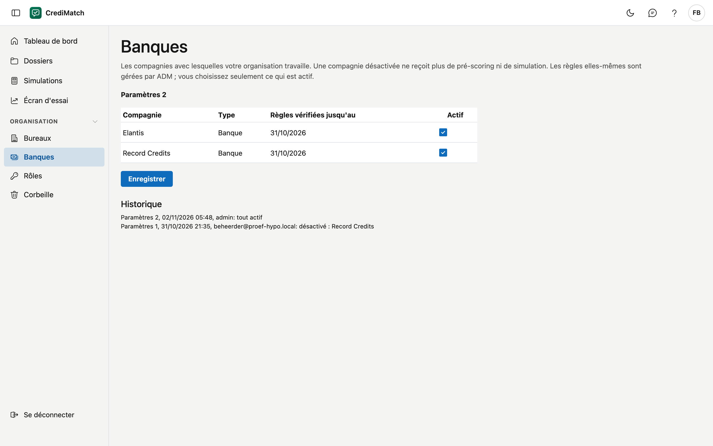

# Banques

Sur cet écran, vous choisissez avec quelles compagnies votre organisation travaille. Une compagnie désactivée ne reçoit plus
de pré-scoring ni de simulation. Les règles d'acceptation des compagnies sont gérées par ADM : vous choisissez seulement ce
qui est actif.

## Ouvrir l'écran

Dans le menu, sous **Organisation**, cliquez sur **Banques**.

## La liste

| Colonne | Ce que c'est |
|---|---|
| Compagnie | le nom de la banque ou de l'assureur |
| Type | **Banque** ou **Assureur** |
| Règles vérifiées jusqu'au | la date des documents les plus récents de cette compagnie intégrés dans les règles |
| Actif | coché si votre organisation travaille avec cette compagnie |

Tant que votre organisation n'a rien choisi, tout est actif. En haut figure alors **Par défaut : tout est actif**.

## Activer ou désactiver une compagnie

L'administrateur de votre organisation peut le faire, ainsi que toute personne disposant du droit **Gérer les banques et
paramètres** (voir [Rôles & droits](rollen.md)).

1. Cochez les compagnies avec lesquelles votre organisation travaille, et décochez celles que vous n'utilisez pas.
2. Cliquez sur **Enregistrer**.

## Historique

Chaque modification reçoit un numéro, par exemple **Paramètres 3**. Sous **Historique**, vous voyez pour chaque numéro qui a
fait la modification, quand, et ce qui était désactivé. Un pré-scoring retient avec quel numéro il a été calculé, pour que
vous puissiez vérifier plus tard quelles compagnies étaient actives.

!!! note "Un pré-scoring est une indication"
    CrediMatch confronte un dossier aux règles publiées d'une compagnie. La compagnie décide toujours elle-même.
