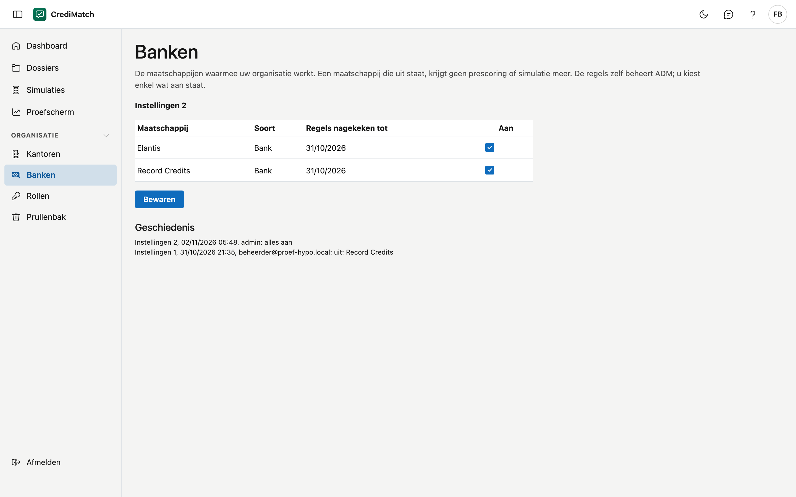

# Banken

Op dit scherm kiest u met welke maatschappijen uw organisatie werkt. Een maatschappij die uit staat, krijgt geen prescoring
of simulatie meer. De aanvaardingsregels van de maatschappijen beheert ADM: u kiest enkel wat aan staat.

## Het scherm openen

Klik in het menu onder **Organisatie** op **Banken**.

## De lijst

| Kolom | Wat het is |
|---|---|
| Maatschappij | de naam van de bank of de verzekeraar |
| Soort | **Bank** of **Verzekeraar** |
| Regels nagekeken tot | de datum van de jongste documenten van die maatschappij die in de regels verwerkt zijn |
| Aan | aangevinkt als uw organisatie met die maatschappij werkt |

Zolang uw organisatie niets gekozen heeft, staat alles aan. Bovenaan staat dan **Standaard: alles staat aan**.

## Een maatschappij aan- of uitzetten

Dit kan de beheerder van uw organisatie, of wie het recht **Banken en instellingen beheren** heeft (zie
[Rollen & rechten](rollen.md)).

1. Vink de maatschappijen aan waarmee uw organisatie werkt, en vink uit wat u niet gebruikt.
2. Klik op **Bewaren**.

## Geschiedenis

Elke wijziging krijgt een nummer, bijvoorbeeld **Instellingen 3**. Onder **Geschiedenis** ziet u per nummer wie de wijziging
deed, wanneer, en wat er uit stond. Een prescoring onthoudt met welk nummer ze berekend werd, zodat u later kunt nagaan welke
maatschappijen toen aan stonden.

!!! note "Een prescoring is een indicatie"
    CrediMatch toetst een dossier aan de gepubliceerde regels van een maatschappij. De maatschappij beslist altijd zelf.
