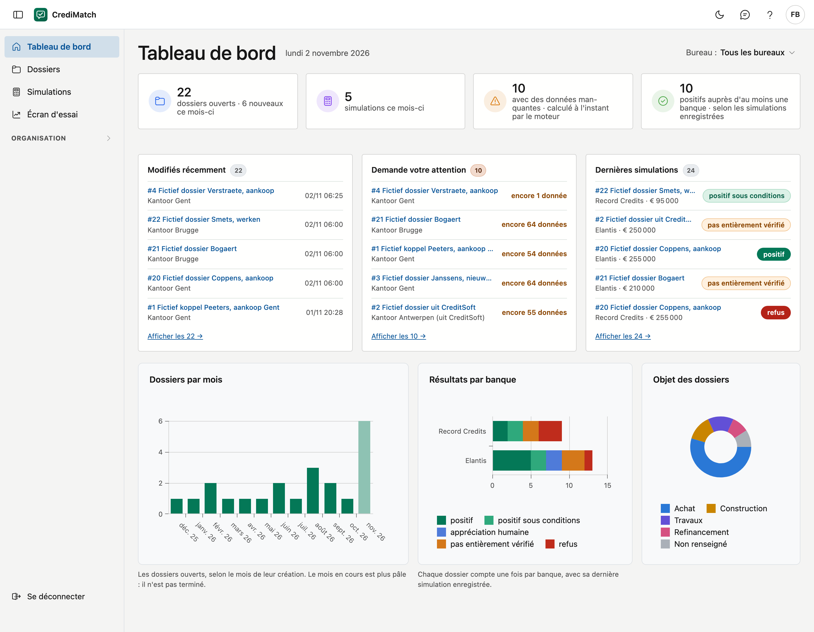

# Tableau de bord

Le tableau de bord est le premier écran après la connexion. Vous voyez combien de dossiers sont ouverts, où les banques
demandent encore des données et comment les banques jugent les simulations enregistrées. Chaque chiffre porte uniquement
sur les bureaux que vous pouvez voir.

!!! note "Environnement d'essai"
    Travaillez uniquement avec des données fictives. Les vrais dossiers ne seront possibles qu'une fois les accords sur
    les données personnelles finalisés.

## Ouvrir l'écran

Vous arrivez sur le tableau de bord après la connexion. Depuis un autre écran, cliquez sur **Tableau de bord** dans le menu.

## Le choix du bureau

Si vous voyez plus d'un bureau, **Bureau** figure en haut à droite, sur **Tous les bureaux**. Choisissez un bureau pour ne
voir que ses chiffres. Les tuiles, les cartes et les graphiques suivent ce choix, et la liste derrière une tuile s'ouvre avec le
même bureau. Si vous ne voyez qu'un seul bureau, il n'y a rien à choisir et ce bouton n'apparaît pas.

## Les chiffres clés

En haut figurent quatre tuiles. Cliquez sur une tuile pour ouvrir la liste qui affiche le même chiffre.

| Tuile | Ce qu'elle compte | Où mène le clic |
|---|---|---|
| **dossiers ouverts** | les dossiers qui ne sont pas à la corbeille, avec le nombre de dossiers créés ce mois-ci | [Dossiers](dossiers.md) |
| **simulations ce mois-ci** | les simulations enregistrées ce mois-ci | [Simulations](simulaties.md), sur la période *Ce mois-ci* |
| **avec des données manquantes** | les dossiers pour lesquels au moins une banque demande encore une donnée | [Dossiers](dossiers.md), avec *Avec des données manquantes* |
| **positifs auprès d'au moins une banque** | les dossiers dont la dernière simulation enregistrée auprès d'au moins une banque est *positif* ou *positif sous conditions* | [Dossiers](dossiers.md), avec *Positif auprès d'au moins une banque* |

**Avec des données manquantes** est calculé au moment où vous ouvrez le tableau de bord, de la même manière que la barre
d'étapes dans un dossier : chaque dossier est vérifié tel qu'il est à ce moment, auprès des banques actives. Cette vérification
n'enregistre rien.

**Positifs auprès d'au moins une banque** provient des simulations enregistrées. Chaque dossier compte par banque avec sa
dernière simulation : une simulation positive plus ancienne, suivie d'un refus, ne compte pas. Si le dossier a été modifié
depuis la simulation, vous ne le voyez pas ici. Un pré-scoring est une indication : la banque décide.

Un chiffre impossible à donner n'est pas affiché comme 0 :

| Vous voyez | Ce que cela signifie |
|---|---|
| **…** | le chiffre est encore en cours de chargement |
| **—** avec *données nécessaires* | aucune banque n'est active pour votre organisation : il n'y a rien pour vérifier (voir [Banques](banken.md)) |
| *… non vérifiés* sur une tuile | ce nombre de dossiers n'a pas pu être vérifié. Ils ne comptent pas dans le chiffre de la tuile |

## Les cartes

Sous les tuiles figurent trois cartes avec les lignes elles-mêmes. Cliquez sur une ligne pour ouvrir le dossier, et en bas sur
**Afficher les …** pour la liste complète.

- **Modifiés récemment :** les cinq derniers dossiers enregistrés. Si vous voyez plus d'un bureau, le bureau est indiqué.
- **Demande votre attention :** les dossiers de la tuile *avec des données manquantes*, les derniers modifiés d'abord, avec le
  nombre de données que les banques demandent encore. Le chiffre à côté du titre est celui de la tuile.
- **Dernières simulations :** les cinq dernières simulations enregistrées, avec la banque, le montant et le résultat. Un même
  dossier peut y figurer deux fois, avec une simulation auprès de deux banques.

S'il n'y a rien à afficher, la carte le dit en une phrase.

## Les graphiques

- **Dossiers par mois :** les dossiers ouverts des douze derniers mois, selon le mois de leur création. Le mois en cours est
  plus pâle : il n'est pas terminé.
- **Résultats par banque :** par banque, le nombre de dossiers pour chaque résultat. Chaque dossier compte une fois par banque,
  avec sa dernière simulation enregistrée : essayer plusieurs fois ne change donc pas le total. La signification des résultats
  figure sous [Pré-scoring et simulations](dossiers.md#pre-scoring-et-simulations).
- **Objet des dossiers :** les dossiers ouverts par objet, en groupes. *Achat* comprend aussi un achat avec travaux ou avec
  rénovation, *Construction* aussi la construction en gestion propre, *Travaux* aussi une rénovation, et *Refinancement* aussi
  un refinancement externe. Un objet saisi à la main figure sous *Autre objet*. Un dossier sans objet figure sous *Non renseigné*.

## Erreurs fréquentes

!!! warning "Vous voyez un message au lieu des chiffres"
    Vous n'êtes encore rattaché à aucun bureau. Demandez à l'administrateur de votre organisation de vous ajouter à un bureau
    (voir [Bureaux](kantoren.md)).

!!! warning "Un collègue voit d'autres chiffres"
    Chaque chiffre porte sur les bureaux que vous pouvez voir, et sur le bureau choisi en haut à droite. Vérifiez d'abord si
    **Bureau** est sur **Tous les bureaux**.

!!! warning "La tuile dit positif, mais pas le pré-scoring du dossier"
    La tuile provient des simulations enregistrées, le pré-scoring du dossier tel qu'il est maintenant. Si le dossier a été
    modifié ou si une autre version des règles s'applique, cela peut différer. Enregistrez une nouvelle simulation pour mettre
    la tuile à jour.

!!! warning "Un dossier reste sur données manquantes"
    Ouvrez le dossier : la liste **Encore … données nécessaires** indique lesquelles et à quelle étape. Si vous savez qu'une chose
    n'existe pas, comme des caractéristiques particulières du bien, cliquez sur **Aucun** à ce champ.

## Voir aussi

- [Dossiers](dossiers.md)
- [Simulations](simulaties.md)
- [Bureaux](kantoren.md)
- [Banques](banken.md)
