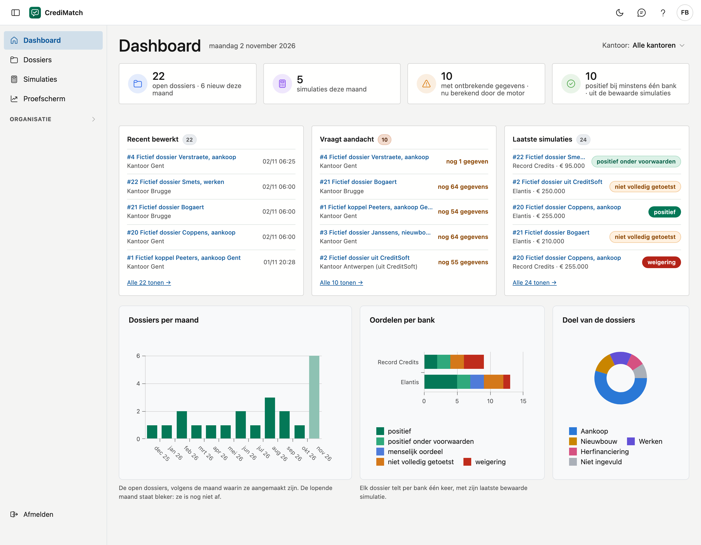

# Dashboard

Het dashboard is het eerste scherm na het aanmelden. U ziet hoeveel dossiers er open staan, waar de banken nog gegevens
vragen en hoe de banken oordelen over de bewaarde simulaties. Elk cijfer gaat enkel over de kantoren die u mag zien.

!!! note "Proefomgeving"
    Werk enkel met fictieve gegevens. Echte dossiers kunnen pas wanneer de afspraken over persoonsgegevens rond zijn.

## Het scherm openen

U komt op het dashboard terecht na het aanmelden. Van op een ander scherm klikt u in het menu op **Dashboard**.

## De kantoorkeuze

Ziet u meer dan één kantoor, dan staat rechtsboven **Kantoor**, op **Alle kantoren**. Kies een kantoor om enkel de cijfers
van dat kantoor te zien. De tegels, de kaarten en de grafieken volgen de keuze, en de lijst achter een tegel opent met
hetzelfde kantoor. Ziet u één kantoor, dan is er niets te kiezen en staat deze knop er niet.

## De kerncijfers

Bovenaan staan vier tegels. Klik op een tegel om de lijst te openen die hetzelfde getal toont.

| Tegel | Wat ze telt | Waar de klik naartoe gaat |
|---|---|---|
| **open dossiers** | de dossiers die niet in de prullenbak staan, met hoeveel er deze maand aangemaakt zijn | [Dossiers](dossiers.md) |
| **simulaties deze maand** | de simulaties die deze maand bewaard zijn | [Simulaties](simulaties.md), op de periode *Deze maand* |
| **met ontbrekende gegevens** | de dossiers waarvoor minstens één bank nog een gegeven vraagt | [Dossiers](dossiers.md), met *Met ontbrekende gegevens* |
| **positief bij minstens één bank** | de dossiers waarvan de laatste bewaarde simulatie bij minstens één bank *positief* of *positief onder voorwaarden* is | [Dossiers](dossiers.md), met *Positief bij minstens één bank* |

**Met ontbrekende gegevens** wordt berekend op het moment dat u het dashboard opent, op dezelfde manier als de stappenbalk in
een dossier: elk dossier wordt getoetst zoals het op dat moment is, bij de banken die aanstaan. Dat toetsen bewaart niets.

**Positief bij minstens één bank** komt uit de bewaarde simulaties. Elk dossier telt per bank met zijn laatste simulatie: een
oudere positieve simulatie die later een weigering kreeg, telt niet. Is het dossier sinds de simulatie gewijzigd, dan ziet u
dat hier niet. Een prescoring is een indicatie: de bank beslist.

Een getal dat niet te geven is, staat niet op 0:

| U ziet | Wat het betekent |
|---|---|
| **…** | het cijfer wordt nog geladen |
| **—** bij *gegevens nodig* | er staat geen bank aan voor uw organisatie, dus er is niets om tegen te toetsen (zie [Banken](banken.md)) |
| *… niet getoetst* bij een tegel | zoveel dossiers konden niet getoetst worden. Ze tellen niet mee in het getal van de tegel |

## De kaarten

Onder de tegels staan drie kaarten met de rijen zelf. Klik op een rij om het dossier te openen, en onderaan op **Alle … tonen**
voor de hele lijst.

- **Recent bewerkt:** de vijf dossiers die het laatst bewaard zijn. Ziet u meer dan één kantoor, dan staat het kantoor erbij.
- **Vraagt aandacht:** de dossiers van de tegel *met ontbrekende gegevens*, de laatst bewerkte eerst, met hoeveel gegevens de
  banken nog vragen. Het getal bij de titel is het getal van de tegel.
- **Laatste simulaties:** de vijf simulaties die het laatst bewaard zijn, met de bank, het bedrag en het oordeel. Eén dossier
  kan er twee keer staan, met een simulatie bij twee banken.

Is er niets te tonen, dan zegt de kaart dat in een zin.

## De grafieken

- **Dossiers per maand:** de open dossiers van de laatste twaalf maanden, volgens de maand waarin ze aangemaakt zijn. De lopende
  maand staat bleker: ze is nog niet af.
- **Oordelen per bank:** per bank hoeveel dossiers bij elk oordeel staan. Elk dossier telt per bank één keer, met zijn laatste
  bewaarde simulatie, dus vaak proberen verandert het totaal niet. De betekenis van de oordelen staat bij
  [Prescoring en simulaties](dossiers.md#prescoring-en-simulaties).
- **Doel van de dossiers:** de open dossiers per doel, in groepen. *Aankoop* is ook een aankoop met werken of met verbouwing,
  *Nieuwbouw* ook bouwen in eigen beheer, *Werken* ook een verbouwing, en *Herfinanciering* ook een externe herfinanciering.
  Een doel dat met de hand getypt werd, staat bij *Ander doel*. Een dossier zonder doel staat bij *Niet ingevuld*.

## Veelgemaakte fouten

!!! warning "U ziet een melding in plaats van cijfers"
    U staat nog op geen enkel kantoor. Vraag de beheerder van uw organisatie om u aan een kantoor toe te voegen (zie
    [Kantoren](kantoren.md)).

!!! warning "Een collega ziet andere cijfers"
    Elk cijfer gaat over de kantoren die u mag zien, en over het kantoor dat u rechtsboven koos. Kijk eerst na of **Kantoor** op
    **Alle kantoren** staat.

!!! warning "De tegel zegt positief, maar de prescoring van het dossier niet"
    De tegel komt uit de bewaarde simulaties, de prescoring uit het dossier zoals het nu is. Is het dossier gewijzigd of is er
    een andere regelversie, dan kan dat verschillen. Bewaar een nieuwe simulatie om de tegel bij te werken.

!!! warning "Een dossier blijft op ontbrekende gegevens staan"
    Open het dossier: de lijst **Nog … gegevens nodig** zegt welke en in welke stap. Weet u dat iets er niet is, zoals bijzondere
    kenmerken van het pand, klik dan bij dat veld op **Geen**.

## Zie ook

- [Dossiers](dossiers.md)
- [Simulaties](simulaties.md)
- [Kantoren](kantoren.md)
- [Banken](banken.md)
