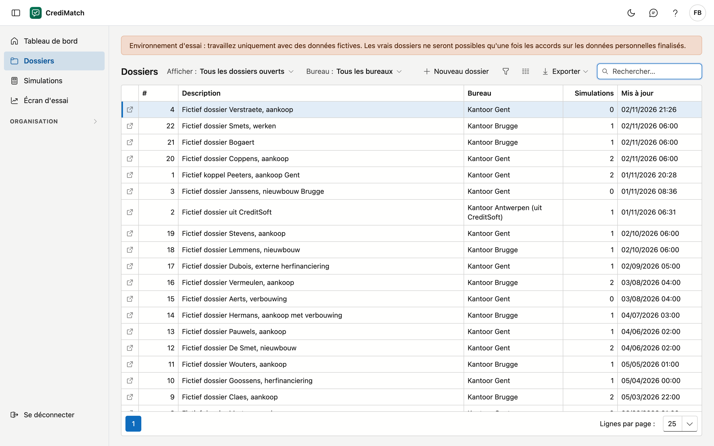
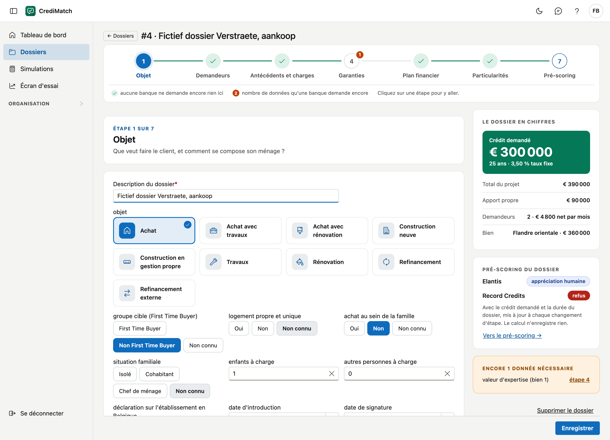
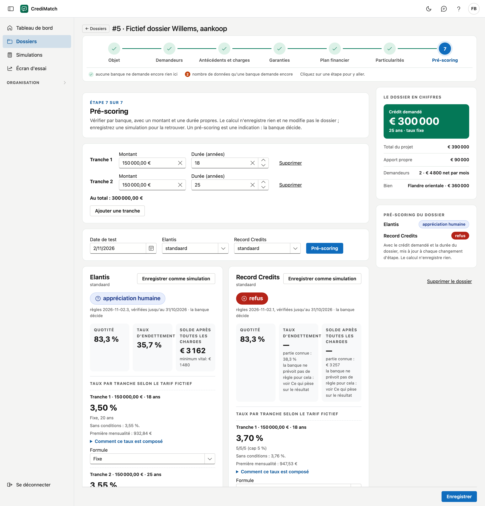
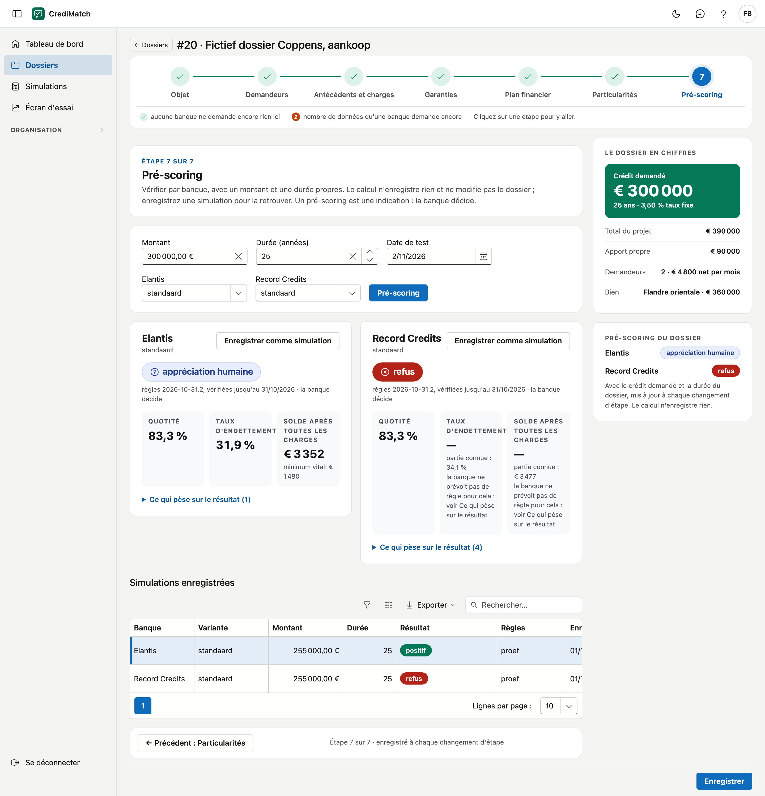

# Dossiers

Sur cet écran, vous gérez les dossiers de crédit de vos bureaux. Vous remplissez un dossier par étapes, dans l'ordre d'un
entretien avec le client, et vous le vérifiez auprès des banques : le pré-scoring. Chaque vérification peut être
enregistrée comme simulation, avec un montant et une durée propres.

!!! note "Environnement d'essai"
    Travaillez uniquement avec des données fictives. Les vrais dossiers ne seront possibles qu'une fois les accords sur
    les données personnelles finalisés.

!!! note "Dossiers d'exemple"
    Un dossier dont la description commence par **Fictief voorbeeld** a été préparé par ADM pour que vous puissiez essayer, avec une
    simulation par banque. Vous pouvez y travailler comme avec n'importe quel autre dossier.

## Ouvrir l'écran

Dans le menu, cliquez sur **Dossiers**. Vous voyez les dossiers des bureaux que vous pouvez voir (voir
[Bureaux](kantoren.md)).

## La liste

| Colonne | Ce que c'est |
|---|---|
| # | le numéro d'ordre du dossier dans votre organisation |
| Description | par exemple le nom du client et l'objet |
| Bureau | le bureau auquel appartient le dossier |
| Simulations | le nombre de simulations enregistrées |
| Mis à jour | la date de la dernière modification des données du dossier. Ouvrir un dossier ou parcourir ses étapes ne compte pas, une simulation enregistrée non plus |

Cliquez sur une ligne pour ouvrir le dossier.

Au-dessus de la liste, vous choisissez ce que vous voulez voir :

- **Afficher :** *Tous les dossiers ouverts*, *Nouveaux ce mois-ci*, *Avec des données manquantes*, *Positif auprès d'au moins
  une banque*, ou *Durée de conservation dépassée*. Ce sont les mêmes dossiers que derrière les tuiles du [Tableau de bord](dashboard.md). Avec *Avec des données
  manquantes*, une colonne **Données nécessaires** s'ajoute, avec le nombre de données que les banques demandent encore.
- **Bureau :** n'apparaît que si vous voyez plus d'un bureau.

## Créer un dossier

1. Cliquez sur **Nouveau dossier**.
2. Choisissez le **Bureau**. Si vous n'avez qu'un seul bureau, il est déjà choisi.
3. Saisissez une **Description**, par exemple le nom du client et l'objet.
4. Cliquez sur **Créer**. Le dossier s'ouvre aussitôt.

## Le dossier par étapes

En haut figure la **barre des étapes**, avec sept étapes dans l'ordre d'un entretien avec le client. Avec **Suivant** et
**Précédent** en bas, vous avancez étape par étape. Vous pouvez aussi sauter : cliquez sur une étape dans la barre, par
exemple pour revenir aux demandeurs si le client avait oublié quelque chose.

| Étape | Ce que vous y remplissez |
|---|---|
| 1. Objet | ce que le client veut faire, son ménage, et la date d'introduction (aujourd'hui pour un nouveau dossier) |
| 2. Demandeurs | pour chaque demandeur, son nom et ses coordonnées, son emploi et ses revenus |
| 3. Antécédents et charges | un enregistrement à la Banque nationale, et les crédits en cours |
| 4. Garanties | les biens : le bien financé et ce qui est donné en garantie |
| 5. Plan financier | les travaux, les frais, les fonds propres, la durée, le taux et le crédit demandé en tranches. Si vous laissez le taux vide, chaque banque calcule avec son propre tarif |
| 6. Particularités | ce qu'une banque ne demande que dans un cas particulier : un refinancement ou une expertise |
| 7. Pré-scoring | vérifier par banque, et enregistrer des simulations |

### Quels champs vous voyez

Vous ne voyez que les champs liés à vos choix :

| Votre choix | Ce qui change |
|---|---|
| **Statut** (étape 2, par demandeur) | un employé, un ouvrier ou un fonctionnaire ne voit pas *indépendant depuis*. Un indépendant ou un dirigeant d'entreprise ne voit pas les questions sur son contrat, son entrée en service, le temps plein, les chèques-repas et une voiture de société. Un pensionné ne voit ni l'un ni l'autre |
| **Type de charge** (étape 3) | pour une ligne de crédit, vous saisissez le montant de la ligne ; pour une autre charge, la mensualité, la date de fin et le solde |
| **A connu un règlement collectif de dettes** (étape 3) | avec *Non*, la question sur sa fin disparaît |
| **Type de taux** (étape 5) | avec un taux fixe, le taux maximal disparaît |
| **Objet** (étape 1) | les questions sur un refinancement à l'étape 6 n'apparaissent que pour l'objet *Refinancement*. À l'étape 4, les *années depuis l'achat* n'apparaissent que pour *Rénovation*, et les *années depuis l'achat du terrain* que pour *Construction neuve* |
| **Certificat PEB disponible** (étape 4, par bien) | avec *Oui*, la dispense de certificat PEB disparaît |
| **Location partielle** (étape 4) | avec *Non*, la question de savoir si l'emprunteur occupe lui-même une entité disparaît |

Tant que vous n'avez rien choisi, tous les champs sont affichés. Un champ déjà rempli reste affiché, même si vous modifiez votre choix. Si une banque demande tout de même une donnée masquée, le champ apparaît chez le demandeur, pour le crédit ou pour le bien concerné.

La question sur un *autre bien belge en pleine propriété en garantie*, à l'étape 4, n'apparaît que si une banque la pose, par exemple pour un bateau-logement ou une très petite unité d'habitation. Les banques demandent les autres champs de cette étape pour chaque dossier : ils restent donc affichés.

### En cas de construction neuve

Si vous choisissez *Construction neuve* à l'étape 1, trois champs changent de nom, car ils portent alors autre chose :

| Champ | Étape | Ce que vous saisissez |
|---|---|---|
| *prix ou valeur du terrain* | 4 | ce que le terrain coûte ou vaut. Pour un achat sur plan : la part du prix pour le terrain |
| *coût de construction (TVAC, architecte et raccordements)* | 5 | ce que la construction coûte. Pour un achat sur plan : la part du prix pour le bâtiment |
| *valeur du bien achevé (expertise)* | 5 | la valeur issue de l'expertise, s'il y en a une. Sinon, laissez le champ vide |

À l'étape 4, à *dispense de certificat PEB*, choisissez **construction neuve** pour le bien à construire : il n'y a pas encore de PEB. Un deuxième bien en garantie n'est pas une construction neuve : vous y saisissez l'expertise et le PEB comme d'habitude.

Les autres choix de cette dispense sont *bien sans PEB*, *sortie d'indivision* et *acquis avant l'obligation PEB*. La banque ne demande alors pas de certificat, mais peut encore demander le chiffre du PEB.

!!! note "Toutes les banques ne calculent pas de la même façon"
    Chez une banque, le terrain et le coût de construction suffisent ; une autre demande en plus une expertise et le PEB. La liste de ce qui manque encore indique ce qu'il faut par banque. Toutes les banques n'acceptent pas la construction en gestion propre.

### L'estimation des frais d'acquisition

À l'étape 5, CrediMatch estime les frais d'acquisition selon les tarifs des notaires. Vous voyez les droits d'enregistrement, les honoraires du notaire, les frais du crédit, les frais administratifs et la TVA, avec le total en dessous.

1. Remplissez l'objet, le bien avec sa province et son prix d'achat, *logement propre et unique* et le crédit demandé. S'il manque quelque chose, l'estimation le demande.
2. Cliquez sur **Reprendre dans le dossier**. Le total arrive dans le champ *frais d'acquisition*, et vous pouvez encore le modifier ensuite.
3. Si le montant du dossier diffère de l'estimation, l'écran l'indique.

Pour des travaux ou un refinancement, vous ne voyez que les frais du crédit. Pour une construction neuve, un terrain, plusieurs biens achetés, un mandat hypothécaire ou un bien à l'étranger, il n'y a pas d'estimation : l'écran explique pourquoi, et vous saisissez les frais vous-même.

!!! note "Une estimation, pas un décompte"
    Le notaire établit le décompte. Les réductions comme la reportabilité n'y sont pas comprises. Le résultat des banques ne dépend presque jamais de ce montant.

### Ce que la barre des étapes vous indique

Chaque étape de la barre montre s'il manque encore quelque chose aux banques :

| Vous voyez | Ce que cela signifie |
|---|---|
| une coche verte | aucune banque ne demande encore une donnée de cette étape |
| un nombre orange | le nombre de données de cette étape qu'une banque demande encore |
| seulement le numéro | rien n'a encore été vérifié, par exemple parce qu'aucune banque n'est active pour votre organisation |

Pour cela, CrediMatch vérifie le dossier tel qu'il est à ce moment, avec le crédit demandé et la durée du dossier : à
l'ouverture et chaque fois que le dossier est enregistré. Cette vérification n'enregistre rien. Une coche indique
seulement qu'aucune banque ne demande encore rien. Elle ne signifie pas que chaque champ de l'étape est rempli.

### À droite : le dossier en chiffres

À côté de chaque étape, vous voyez le dossier en chiffres : le crédit demandé (la somme des tranches) avec la durée et le
taux, le total du projet, l'apport propre, le nombre de demandeurs avec leur revenu net ensemble, et le bien. En
dessous figurent le résultat par banque, et la liste **Encore … données nécessaires** avec un bouton vers l'étape où vous
saisissez chaque donnée. Si un montant n'est pas encore saisi, un tiret apparaît et l'écran indique quel montant manque. Avec plusieurs tranches, vous voyez par exemple *2 tranches · jusqu'à 25 ans*.

Vous ajoutez un demandeur, un crédit en cours, un bien ou une tranche avec le bouton sous l'étape (par exemple **Ajouter
un demandeur** ou **Ajouter une tranche**). Vous en retirez un avec **Supprimer** en haut de sa carte.

{ .volle-breedte }

### Ce que vous ne savez pas, laissez-le vide

Un champ vide signifie **non connu**. Le pré-scoring indique alors la donnée manquante, au lieu de deviner.

- Pour une question **oui/non**, trois boutons figurent côte à côte : **Oui**, **Non** et **Non connu**. *Non connu*
  est autre chose que *Non* : le pré-scoring le signale comme manquant.
- Une liste courte, comme la situation familiale ou le groupe cible, se choisit aussi avec des boutons, avec **Non
  connu** en plus.
- L'**objet** se choisit avec une carte, par exemple **Achat avec travaux**. Si vous cliquez encore sur la carte choisie,
  l'objet redevient *non connu*.
- Un champ où vous pouvez indiquer plusieurs choix, comme les **caractéristiques du bien**, a deux boutons en dessous : **Aucun**
  si aucun choix ne s'applique, et **Non connu** si vous ne le savez pas encore. Le pré-scoring signale *Non connu* comme
  manquant, pas *Aucun*. Cochez tout ce qui s'applique, même si cela se ressemble : chaque banque utilise ses propres termes.
  Si vous choisissez *Aucun* alors que quelque chose s'applique, le résultat peut être trop favorable.
- Un montant nul se saisit **0**. S'il n'y a pas de travaux, saisissez **0** aux travaux : vide signifie que les
  travaux ne sont pas connus. C'est aussi indiqué sous le champ.

### L'aperçu du plan financier

Sous l'étape **Plan financier** figure un aperçu : le prix d'achat des biens, les travaux, les frais d'acquisition, le
total du projet, le crédit demandé (la somme des tranches) et l'apport propre (la différence). C'est un contrôle. Un
montant qui n'est pas encore saisi apparaît comme un tiret : sans tous les montants, il n'y a pas de total, et l'écran
indique quel montant manque. La quotité et le taux d'endettement sont calculés par chaque banque à sa façon : vous les
voyez au pré-scoring.

### Documents

Sous chaque étape se trouve le bloc **Documents**. Cliquez dessus pour l'ouvrir.

1. Cliquez sur **Pièce jointe** et choisissez un ou plusieurs fichiers, jusqu'à 25 Mo par fichier.
2. Le fichier apparaît dans la liste. Le nom permet de le télécharger. Un PDF ou une photo peut aussi être consulté dans le navigateur.
3. Le menu **⋯** permet de modifier la description ou de supprimer le document.

Chaque document est enregistré de façon chiffrée, et seuls ceux qui peuvent voir ce bureau peuvent l'ouvrir. Pour un dossier provenant d'une autre application, vous pouvez uniquement consulter les documents.

!!! warning "Uniquement des documents fictifs"
    Dans l'environnement d'essai, vous travaillez uniquement avec des documents fictifs. Les documents réels ne seront possibles que lorsque les accords sur les données personnelles seront conclus.

### La durée de conservation d'un dossier

À droite dans le dossier, vous voyez jusqu'à quand il est conservé, selon la [durée de conservation](bewaartermijn.md) de votre organisation. Si cette date est dépassée, **dépassée** s'affiche. CrediMatch ne supprime rien automatiquement.

Un dossier doit rester plus longtemps, par exemple parce que le crédit est toujours en cours ? Cliquez sur **Prolonger**, choisissez une date dans le futur et indiquez la raison. La raison reste sur le dossier et figure aussi dans un export. Le bouton **Retirer la prolongation** remet le dossier sur la durée habituelle. Une prolongation ne peut que conserver un dossier plus longtemps, jamais moins, et elle ne compte pas comme une modification des données. C'est aussi possible pour un dossier provenant d'une autre application.

### Exporter un dossier

Cliquez à droite dans le dossier sur **Exporter le dossier**, puis sur **Télécharger**. Vous obtenez un fichier zip avec tout ce que CrediMatch conserve sur ce dossier, par exemple lorsqu'un client demande quelles données vous détenez sur lui.

| Dans le zip | Ce que c'est |
|---|---|
| `overzicht.pdf` | Le dossier à lire : les données par étape, les demandeurs, les simulations enregistrées et la liste des documents |
| `gegevens.json` | Les mêmes données pour un autre logiciel, avec aussi tout ce que chaque simulation a reçu et donné |
| `documenten/` | Les fichiers chargés |
| `documenten/verwijderd/` | Les documents que vous avez supprimés, car ils sont encore conservés |

- Ce que vous venez de saisir est d'abord enregistré.
- Les résultats et les taux de l'export sont indicatifs : la banque décide toujours.
- L'historique des modifications n'y figure pas.
- CrediMatch note qui a exporté et quand.
- Vous pouvez aussi exporter un dossier provenant d'une autre application. Pas un dossier dans la [Corbeille](prullenbak.md) : remettez-le d'abord.

!!! warning "Le fichier n'est pas chiffré"
    Sur votre ordinateur, l'export est lisible tel quel. Conservez-le en lieu sûr et supprimez-le lorsque vous n'en avez plus besoin. Si le dossier contient plusieurs demandeurs, leurs données figurent ensemble dans l'export : vérifiez ce que vous transmettez avant de le remettre à l'un d'eux.

!!! note "Incomplet"
    Si **Attention** figure en haut de l'aperçu, un document n'a pas pu être lu et ne se trouve pas dans le zip. Le reste est correct. Signalez-le à ADM-Concept.

### Supprimer un dossier

Cliquez à droite dans le dossier sur **Supprimer le dossier** et confirmez. Le dossier va à la [Corbeille](prullenbak.md), avec ses
simulations. Il ne figure alors plus dans **Dossiers**, dans **Simulations** ni sur le tableau de bord. Avec **Restaurer**, vous le
remettez, avec ses simulations. Un dossier provenant d'un autre logiciel est ici en lecture seule et n'a pas ce bouton.

### Supprimer définitivement un dossier

La suppression définitive est autre chose que la suppression. Un dossier dans la [Corbeille](prullenbak.md) reste conservé et peut revenir. Un dossier supprimé définitivement a réellement disparu. Utilisez cette fonction uniquement à la demande de la personne concernée ou lorsque la [durée de conservation](bewaartermijn.md) est dépassée. Si quelque chose a simplement été mal saisi, utilisez **Supprimer le dossier**.

Vous avez besoin du droit **Supprimer définitivement des dossiers** (voir [Rôles & droits](rollen.md)). Par défaut, seul l'administrateur de votre organisation en dispose.

1. Cliquez à droite dans le dossier sur **Supprimer définitivement**. Vous trouvez aussi ce bouton sous [Dossiers](#la-liste), avec *Durée de conservation dépassée* dans le choix **Afficher**. Un dossier qui se trouve depuis 30 jours dans la corbeille y figure aussi. S'il s'y trouve depuis moins longtemps, remettez-le d'abord : dans la corbeille, il n'a pas ce bouton.
2. Choisissez la raison : *Demande de la personne concernée* ou *Durée de conservation dépassée*.
3. Saisissez le numéro de dossier et cliquez sur **Supprimer définitivement**.

Le dossier, ses demandeurs, simulations et documents disparaissent, y compris les documents que vous aviez déjà supprimés, ainsi que leur historique. C'est aussi possible pour un dossier provenant d'une autre application. Cette application ne peut ensuite plus le renvoyer.

Ce qui reste ne contient aucune donnée sur la personne concernée : le journal indique par exemple *Dossier 12 gewist (verzoek van de betrokkene), 3 documenten, 5 simulaties*. Le numéro n'est pas réutilisé.

!!! warning "Cette action est irréversible"
    Votre bureau décide si la suppression est autorisée : une obligation légale de conservation peut primer. Vérifiez-le avant de cliquer.

!!! note "Ce que la suppression n'atteint pas"
    Ce qui se trouve en dehors de CrediMatch, vous devez le supprimer vous-même : un [export](#exporter-un-dossier) ou une impression sur votre ordinateur, et ce qu'une banque ou une autre application a déjà reçu. Dans les sauvegardes de CrediMatch, les données restent jusqu'à l'expiration de ces sauvegardes. Si une sauvegarde est un jour restaurée, CrediMatch supprime à nouveau le dossier.

### Enregistrer

Le dossier est enregistré chaque fois que vous passez à une autre étape : avec **Suivant**, avec **Précédent** ou en
cliquant sur la barre des étapes. En bas, vous voyez l'heure du dernier enregistrement. Si vous voulez rester sur une
étape, cliquez sur **Enregistrer**.

Si l'enregistrement échoue, par exemple parce que la description est vide, vous passez quand même à l'étape choisie. Ce
que vous avez saisi reste, et le message reste en haut jusqu'à ce que l'enregistrement réussisse. Si vous quittez le
dossier avec des modifications non enregistrées, l'écran vous demande d'abord si vous voulez vraiment partir.

## Pré-scoring et simulations

1. Ouvrez l'étape **7. Pré-scoring**.
2. Vérifiez le **Montant** et la **Durée (années)**. Ils reprennent le crédit demandé et la durée du dossier ; vous
   pouvez vérifier un autre montant ou une autre durée. Si le dossier compte plusieurs tranches, il y a une ligne par tranche.
3. Choisissez éventuellement une autre **Date de test**, ou une autre variante pour une banque.
4. Cliquez sur **Pré-scoring**.

Chaque banque reçoit une carte ; les banques figurent côte à côte, pour que vous puissiez les comparer. Sur chaque carte :

- le **résultat**, en grand en haut, avec la version des règles et la date jusqu'à laquelle elles sont vérifiées ;
- trois chiffres clés, tels que cette banque les calcule : la **quotité**, le **taux d'endettement** et le **solde après
  toutes les charges**, avec le minimum vital en dessous. Si la banque ne peut pas encore calculer un chiffre, un tiret
  apparaît avec une raison courte, et la partie déjà connue. L'explication complète figure sous **Ce qui pèse sur le
  résultat** ;
- le **taux** de cette banque, avec la mensualité et vos choix (voir [Le taux par banque](#le-taux-par-banque)) ;
- s'il manque des données, la liste **Ces données manquent**, chaque donnée une seule fois, avec un bouton **vers
  l'étape …** qui ouvre la bonne étape. S'il y en a beaucoup, vous voyez les six premières ; les autres s'ouvrent avec
  **Afficher les … autres** ;
- **Ce qui pèse sur le résultat** : cliquez dessus pour voir les règles qui pèsent sur le résultat, avec la raison.

| Résultat | Ce que cela signifie |
|---|---|
| positif | aucune règle ne bloque le dossier |
| positif sous conditions | c'est possible, sous une condition indiquée à la règle |
| appréciation humaine | la banque juge elle-même ce cas : ses règles le laissent ouvert ou n'en disent rien |
| pas entièrement vérifié | il manque une donnée, ou quelque chose que CrediMatch ne peut pas vérifier : la raison est indiquée |
| refus | une règle de la banque exclut le dossier |

Le calcul n'enregistre rien et ne modifie pas le dossier. Un pré-scoring est une indication : la banque décide.

### Un crédit en plusieurs tranches

Un crédit peut comporter plusieurs tranches, chacune avec sa durée, sa formule et son remboursement. Vous l'utilisez surtout lorsqu'un
demandeur aura plus de 67 ans à l'échéance du crédit. Après la pension, son revenu compte moins, et les banques conseillent alors deux
tranches : l'une remboursée avant la pension. Cette mensualité disparaît ensuite.

À l'étape **Pré-scoring** :

1. Si un demandeur aura plus de 67 ans à l'échéance, le bouton **Scinder jusqu'à 67 ans** apparaît. Cliquez dessus. Vous obtenez deux
   tranches : la courte sur le plus grand nombre d'années entières remboursé au 67e anniversaire, et la moitié du montant chacune. CrediMatch
   calcule aussitôt.
2. Cette moitié est un début, pas un conseil. Adaptez les montants et cliquez sur **Pré-scoring**. La tranche courte augmente la mensualité
   avant la pension, et celle-ci doit aussi passer la vérification.
3. Avec **Ajouter une tranche** et **Supprimer**, vous choisissez vous-même le nombre de tranches à vérifier. Le dossier n'est pas modifié.

Si les tranches font partie du dossier, ajoutez-les à l'étape 5, avec **Ajouter une tranche**. À partir de deux tranches, la durée, le type de
taux, le taux et le remboursement apparaissent par tranche. Ce que vous laissez vide pour une tranche suit ce qui figure en haut : ce choix
s'appelle donc **Comme ci-dessus**.

Sur la carte d'une banque figurent par tranche le taux, la première mensualité, la composition et la **Formule**, que vous choisissez par
tranche. En dessous figure la **Première mensualité, au total**. La quotité, les conditions et la réduction valent pour tout le crédit.

!!! note "Là où la banque ne dit rien"
    Les documents des banques ne disent pas toujours comment une règle s'applique à plusieurs tranches. CrediMatch choisit alors la lecture
    la plus stricte : si une banque demande par exemple un taux fixe, CrediMatch le demande pour chaque tranche. La banque décide.

{ .volle-breedte }

### Le taux par banque

Chaque banque vérifie avec son propre taux, issu de son tarif en vigueur à la **Date de test**. Les banques gèrent elles-mêmes leurs tarifs et les
modifient souvent : la même vérification peut donner un autre taux la semaine prochaine.

!!! note "Taux fictifs"
    Les taux, les réductions et les noms sur les images de ce manuel sont inventés. Les tarifs des banques ne sont visibles que dans
    CrediMatch, après la connexion.

Sur la carte d'une banque :

- **Taux selon le tarif …** : le taux, avec la formule et la durée en dessous, et depuis quand ce tarif est en vigueur. S'il y a des conditions, le taux sans ces conditions figure aussi ;
- **Première mensualité**, pour un taux variable aussi **Mensualité au taux maximal**, et les **Frais de dossier** si la banque les mentionne ;
- **Comment ce taux est composé** : cliquez dessus pour voir le taux de base, les réductions et les majorations ;
- **Formule** : la formule qui correspond au type de taux du dossier. Vous pouvez en choisir une autre. Si aucune ne correspond, un trait figure à côté du taux et la carte demande d'en choisir une. Cela ne compte pas comme une donnée manquante ;
- **Réduction commerciale** : la réduction définie par votre organisation (voir [Banques](banken.md)). Vous choisissez dans la limite du plafond ; si vous ne choisissez rien, le standard s'applique ;
- les **conditions** de la banque, par exemple un compte à vue ou une assurance : elles sont cochées, et vous décochez ce que votre client ne prend pas. Le taux est recalculé aussitôt.

CrediMatch retient ce que vous choisissez. La formule, la réduction et les conditions restent par banque dans le dossier : si vous le rouvrez plus tard, la carte calcule immédiatement avec votre choix, et le tableau de bord en tient compte. Les données du dossier et sa date de mise à jour n'en sont pas modifiées.

Ce qui découle du dossier, comme la quotité et la performance énergétique, vous ne le choisissez pas : la carte en tient compte. CrediMatch n'affiche pas de TAEG : il figure dans l'ESIS de la banque.

Ce qui peut figurer sur la carte à la place du tarif :

| Vous voyez | Ce que cela signifie |
|---|---|
| **Taux propre du dossier** | un taux figure à l'étape 5. Il l'emporte, pour chaque banque. La carte indique aussi ce que le tarif donnerait. Laissez le taux vide pour calculer avec le tarif |
| un trait et *Aucun tarif* | la banque n'a pas de tarif à la date de test. Saisissez un taux à l'étape 5, ou choisissez une autre date |
| un trait et *La quotité n'est pas connue* | le taux dépend de la quotité. Complétez d'abord les données qui manquent en dessous |
| un trait pour une formule choisie auparavant | le tarif en vigueur ne connaît plus cette formule. Choisissez-en une autre |
| *Saisissez le taux pour chaque tranche, ou pour aucune* | un taux propre figure pour une partie des tranches. Saisissez-le partout, ou videz-le partout |

### Enregistrer une simulation

Pour une banque, cliquez sur **Enregistrer comme simulation**. La simulation apparaît dans le tableau **Simulations
enregistrées**, avec son propre montant et sa propre durée, le résultat, le taux avec la formule et la mensualité, et la date de
l'enregistrement. La variante, la version du tarif et des règles, et l'auteur s'affichent avec le choix des colonnes. Vous pouvez ainsi faire varier le montant ou la durée jusqu'à ce que cela passe, sans modifier le
dossier lui-même.

Une banque que votre organisation a désactivée (voir [Banques](banken.md)) n'est pas vérifiée. Elle figure en bas sous
**Désactivées par votre organisation**.

{ .volle-breedte }

Avec plusieurs tranches, une simulation enregistre le montant total et la durée la plus longue. Les formules figurent côte à côte, et le taux reste
vide s'il diffère.

Toutes les simulations enregistrées de vos bureaux figurent ensemble sur l'écran [Simulations](simulaties.md).

## Erreurs fréquentes

!!! warning "Presque chaque règle donne pas entièrement vérifié"
    Il manque une donnée dont la banque a besoin, par exemple la date de naissance d'un demandeur. La liste **Ces données
    manquent** indique lesquelles. Cliquez sur **vers l'étape …** et complétez-les. Revenez ensuite à l'étape
    **Pré-scoring** et cliquez à nouveau sur **Pré-scoring** : la barre des étapes montre déjà quelles étapes manquent
    encore de quelque chose.

!!! warning "Toutes les banques affichent le même taux"
    Un taux figure à l'étape 5 : il l'emporte pour chaque banque. Videz-le pour calculer avec le tarif de chaque banque.

!!! warning "Après la scission, la mensualité est plus élevée"
    C'est normal : une tranche plus courte a une mensualité plus élevée. Le client paie donc plus avant la pension, et moins après. Si la
    banque refuse encore, adaptez les montants : moins dans la tranche courte réduit la mensualité avant la pension.

!!! warning "Le dossier d'un collègue n'apparaît pas dans la liste"
    Vous ne voyez que les dossiers des bureaux que vous pouvez voir. Demandez à l'administrateur de votre organisation de
    vous ajouter à ce bureau (voir [Bureaux](kantoren.md)).

!!! warning "Une banque manque au pré-scoring"
    Votre organisation l'a désactivée. Vous le voyez sous **Organisation** > **Banques**.

## Voir aussi

- [Tableau de bord](dashboard.md)
- [Simulations](simulaties.md)
- [Bureaux](kantoren.md)
- [Banques](banken.md)
