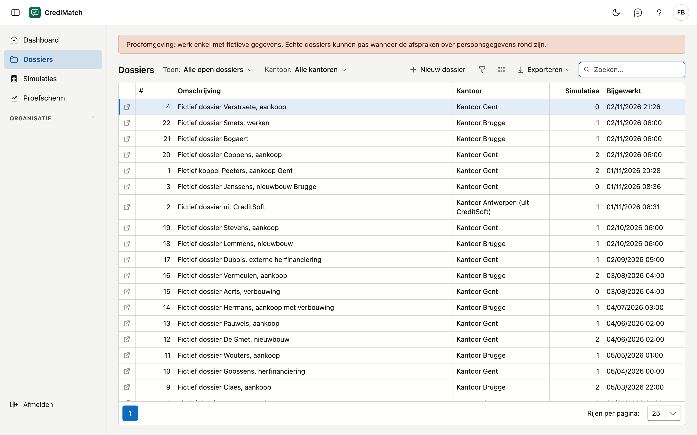
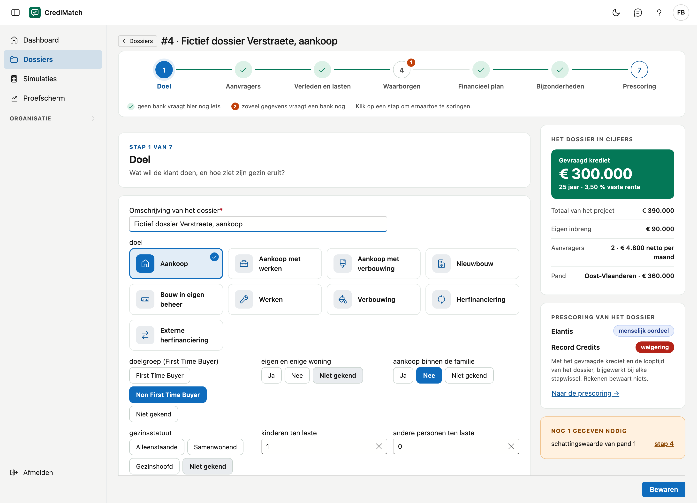
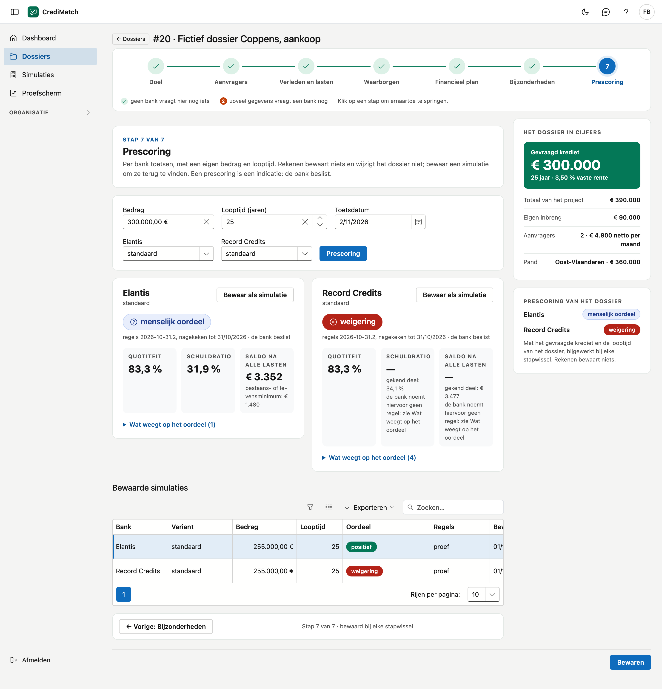

# Dossiers

Op dit scherm beheert u de kredietdossiers van uw kantoren. U vult een dossier in stappen in, in de volgorde van een
gesprek met de klant, en toetst het bij de banken: de prescoring. Elke toets kunt u met een eigen bedrag en looptijd
bewaren als simulatie.

!!! note "Proefomgeving"
    Werk enkel met fictieve gegevens. Echte dossiers kunnen pas wanneer de afspraken over persoonsgegevens rond zijn.

!!! note "Voorbeelddossiers"
    Een dossier waarvan de omschrijving begint met **Fictief voorbeeld**, zette ADM klaar om mee te proberen, met een simulatie per
    bank. U kunt ermee werken zoals met elk ander dossier.

## Het scherm openen

Klik in het menu op **Dossiers**. U ziet de dossiers van de kantoren die u mag zien (zie [Kantoren](kantoren.md)).

## De lijst

| Kolom | Wat het is |
|---|---|
| # | het volgnummer van het dossier in uw organisatie |
| Omschrijving | bijvoorbeeld de naam van de klant en het doel |
| Kantoor | het kantoor waar het dossier bij hoort |
| Simulaties | het aantal bewaarde simulaties |
| Bijgewerkt | wanneer het dossier het laatst bewaard werd |

Klik op een rij om het dossier te openen.

Boven de lijst kiest u wat u wil zien:

- **Toon:** *Alle open dossiers*, *Nieuw deze maand*, *Met ontbrekende gegevens* of *Positief bij minstens één bank*. Dit zijn
  dezelfde dossiers als achter de tegels op het [Dashboard](dashboard.md). Bij *Met ontbrekende gegevens* komt er een kolom
  **Gegevens nodig** bij, met hoeveel gegevens de banken nog vragen.
- **Kantoor:** staat er enkel als u meer dan één kantoor ziet.

## Een dossier aanmaken

1. Klik op **Nieuw dossier**.
2. Kies het **Kantoor**. Hebt u maar één kantoor, dan staat het al gekozen.
3. Vul een **Omschrijving** in, bijvoorbeeld de naam van de klant en het doel.
4. Klik op **Aanmaken**. Het dossier gaat meteen open.

## Het dossier in stappen

Bovenaan staat de **stappenbalk** met zeven stappen, in de volgorde van een gesprek met de klant. Met **Volgende** en
**Vorige** onderaan gaat u stap voor stap verder. U mag ook springen: klik op een stap in de balk, bijvoorbeeld terug naar
de aanvragers als de klant iets vergeten was.

| Stap | Wat u er invult |
|---|---|
| 1. Doel | wat de klant wil doen, zijn gezin, en de datum van indiening (bij een nieuw dossier staat die op vandaag) |
| 2. Aanvragers | per aanvrager zijn naam en contactgegevens, zijn werk en zijn inkomen |
| 3. Verleden en lasten | een vermelding bij de Nationale Bank, en de kredieten die al lopen |
| 4. Waarborgen | de panden: het gefinancierde pand en wat er verder in waarborg gaat |
| 5. Financieel plan | de werken, de kosten, de eigen middelen, de looptijd, de rente en het gevraagde krediet in schijven. Laat u de rente leeg, dan rekent elke bank met haar eigen tarief |
| 6. Bijzonderheden | wat een bank enkel in een bijzonder geval vraagt: een herfinanciering of een schatting |
| 7. Prescoring | per bank toetsen, en simulaties bewaren |

### Welke velden u ziet

U ziet enkel de velden die bij uw keuzes horen:

| Uw keuze | Wat er verandert |
|---|---|
| **Statuut** (stap 2, per aanvrager) | een bediende, arbeider of ambtenaar ziet *zelfstandig sinds* niet. Een zelfstandige of bedrijfsleider ziet de vragen over zijn contract, zijn indiensttreding, voltijds werken, maaltijdcheques en een bedrijfswagen niet. Een gepensioneerde ziet geen van beide |
| **Soort last** (stap 3) | bij een kredietlijn vult u het bedrag van de lijn in; bij een andere last de maandlast, de einddatum en het saldo |
| **Collectieve schuldenregeling gehad** (stap 3) | bij *Nee* vervalt de vraag naar het einde ervan |
| **Rentetype** (stap 5) | bij een vaste rente vervalt de maximale rentevoet |
| **Doel** (stap 1) | de vragen over een herfinanciering in stap 6 staan er enkel bij het doel *Herfinanciering* |

Hebt u nog niets gekozen, dan staan alle velden er. Een veld dat u al invulde, blijft staan, ook als u uw keuze wijzigt. Vraagt een bank toch een gegeven dat verborgen is, dan verschijnt het veld bij de aanvrager of het krediet waar het ontbreekt.

### De raming van de aankoopkosten

In stap 5 raamt CrediMatch de aankoopkosten volgens de tarieven van de notarissen. U ziet de registratierechten, het ereloon van de notaris, de kosten van het krediet, de administratie en de btw, met het totaal eronder.

1. Vul het doel, het pand met zijn provincie en aankoopprijs, *eigen en enige woning* en het gevraagde krediet in. Ontbreekt er iets, dan vraagt de raming het.
2. Klik op **Overnemen in het dossier**. Het totaal komt in het veld *aankoopkosten*, en u kan het daarna nog wijzigen.
3. Wijkt het bedrag in het dossier af van de raming, dan zegt het scherm dat.

Bij werken of een herfinanciering ziet u enkel de kosten van het krediet. Bij nieuwbouw, grond, meerdere gekochte panden, een hypothecair mandaat of een pand in het buitenland is er geen raming: het scherm zegt waarom, en u vult de kosten zelf in.

!!! note "Een raming, geen afrekening"
    De notaris maakt de afrekening. Verminderingen zoals de meeneembaarheid zitten er niet in. Het oordeel van de banken hangt bijna nooit van dit bedrag af.

### Wat de stappenbalk u vertelt

Elke stap in de balk toont of er bij de banken nog iets ontbreekt:

| U ziet | Wat het betekent |
|---|---|
| een groen vinkje | geen enkele bank vraagt in deze stap nog een gegeven |
| een oranje getal | zoveel gegevens uit deze stap vraagt een bank nog |
| enkel het nummer | er is nog niet getoetst, bijvoorbeeld omdat er geen bank aanstaat voor uw organisatie |

Daarvoor toetst CrediMatch het dossier zoals het op dat moment is, met het gevraagde krediet en de looptijd van het
dossier: bij het openen en telkens wanneer het dossier bewaard wordt. Dat toetsen bewaart niets. Een vinkje zegt enkel
dat geen bank er nog iets vraagt. Het zegt niet dat elk veld van de stap ingevuld is.

### Rechts: het dossier in cijfers

Naast elke stap ziet u het dossier in cijfers: het gevraagde krediet (de som van de schijven) met de looptijd en de
rente, het totaal van het project, de eigen inbreng, het aantal aanvragers met hun netto inkomen samen, en het pand.
Daaronder staat het oordeel per bank, en de lijst **Nog … gegevens nodig** met een knop naar de stap waar u elk gegeven
invult. Is een bedrag nog niet ingevuld, dan staat er een streep en zegt het scherm welk bedrag ontbreekt.

Een aanvrager, een lopend krediet, een pand of een schijf voegt u toe met de knop onder de stap (bijvoorbeeld **Aanvrager
toevoegen** of **Schijf toevoegen**). U haalt er een weg met **Verwijderen** bovenaan zijn kaart.

{ .volle-breedte }

### Wat u niet weet, laat u leeg

Een leeg veld betekent **niet gekend**. De prescoring zegt dan welk gegeven ontbreekt, in plaats van te gokken.

- Bij een vraag **ja/nee** staan drie knoppen naast elkaar: **Ja**, **Nee** en **Niet gekend**. *Niet gekend* is iets
  anders dan *Nee*: de prescoring meldt het als ontbrekend.
- Een korte lijst, zoals het gezinsstatuut of de doelgroep, kiest u ook met knoppen, met **Niet gekend** erbij.
- Het **doel** kiest u met een kaart, bijvoorbeeld **Aankoop met werken**. Klikt u nog eens op de gekozen kaart, dan
  staat het doel weer op *niet gekend*.
- Een veld waarin u meerdere keuzes kunt aanduiden, zoals de **kenmerken van het pand**, heeft twee knoppen eronder: **Geen**
  als er geen enkele van toepassing is, en **Niet gekend** als u het nog niet weet. *Niet gekend* meldt de prescoring als
  ontbrekend, *Geen* niet.
- Een bedrag dat nul is, vult u in als **0**. Zijn er geen werken, vul dan **0** in bij de werken: leeg betekent dat de
  werken niet gekend zijn. Dat staat ook onder het veld.

### Het overzicht in het financieel plan

Onder de stap **Financieel plan** staat een overzicht: de aankoopprijs van de panden, de werken, de aankoopkosten, het
totaal van het project, het gevraagde krediet (de som van de schijven) en de eigen inbreng (het verschil). Het is een
controle. Een bedrag dat nog niet ingevuld is, staat als een streep: zonder alle bedragen is er geen totaal, en het
scherm zegt welk bedrag ontbreekt. De quotiteit en de schuldratio berekent elke bank op haar manier: die ziet u bij de
prescoring.

### Bewaren

Het dossier wordt bewaard telkens u naar een andere stap gaat: met **Volgende**, met **Vorige** of met een klik op de
stappenbalk. Onderaan ziet u om hoe laat het laatst bewaard werd. Wilt u op een stap blijven, klik dan op **Bewaren**.

Lukt het bewaren niet, bijvoorbeeld omdat de omschrijving leeg is, dan gaat u toch naar de stap die u koos. Wat u
invulde, blijft staan, en de melding blijft bovenaan staan tot het bewaren lukt. Verlaat u het dossier met wijzigingen die
nog niet bewaard zijn, dan vraagt het scherm eerst of u toch wil weggaan.

### Een dossier verwijderen

Klik rechts in het dossier op **Dossier verwijderen** en bevestig. Het dossier gaat naar de [Prullenbak](prullenbak.md), samen
met zijn simulaties. Het staat dan niet meer in **Dossiers**, in **Simulaties** of op het dashboard. Met **Herstellen** zet u
het terug, met zijn simulaties. Een dossier dat uit een ander pakket komt, is hier enkel leesbaar en heeft die knop niet.

## Prescoring en simulaties

1. Open de stap **7. Prescoring**.
2. Kijk het **Bedrag** en de **Looptijd (jaren)** na. Ze staan op het gevraagde krediet en de looptijd van het dossier; u kunt
   een ander bedrag of een andere looptijd toetsen.
3. Kies eventueel een andere **Toetsdatum**, of bij een bank een andere variant.
4. Klik op **Prescoring**.

Per bank krijgt u een kaart; de banken staan naast elkaar, zodat u ze kunt vergelijken. Op elke kaart:

- het **oordeel**, groot bovenaan, met de versie van de regels en tot wanneer ze nagekeken zijn;
- drie kerncijfers, zoals die bank ze rekent: de **quotiteit**, de **schuldratio** en het **saldo na alle lasten**,
  met het bestaans- of levensminimum eronder. Kan de bank een cijfer nog niet berekenen, dan staat er een streep met een
  korte reden, en het deel dat al gekend is. De volledige uitleg staat bij **Wat weegt op het oordeel**;
- de **rente** van die bank, met de maandlast en uw keuzes (zie [De rente per bank](#de-rente-per-bank));
- ontbreken er gegevens, dan de lijst **Deze gegevens ontbreken**, met elk gegeven één keer en een knop **naar stap …**
  die de juiste stap opent. Zijn het er veel, dan ziet u de eerste zes; de andere opent u met **Toon de … andere**;
- **Wat weegt op het oordeel**: klik erop om de regels te zien die op het oordeel wegen, met de reden.

| Oordeel | Wat het betekent |
|---|---|
| positief | geen enkele regel houdt het dossier tegen |
| positief onder voorwaarden | het kan, onder een voorwaarde die bij de regel staat |
| menselijk oordeel | de bank beoordeelt dit zelf: haar regels laten het open of zeggen er niets over |
| niet volledig getoetst | er ontbreekt een gegeven, of iets wat CrediMatch niet kan toetsen: de reden staat erbij |
| weigering | een regel van de bank sluit het dossier uit |

Rekenen bewaart niets en wijzigt het dossier niet. Een prescoring is een indicatie: de bank beslist.

### De rente per bank

Elke bank toetst met haar eigen rente, uit haar tarief dat op de **Toetsdatum** geldt. De banken beheren hun tarieven zelf en wijzigen
ze vaak: dezelfde toets kan volgende week een andere rente geven.

!!! note "Fictieve rentes"
    De rentes, kortingen en namen op de beelden van deze handleiding zijn verzonnen. De tarieven van de banken ziet u enkel in
    CrediMatch zelf, na het aanmelden.

Op de kaart van een bank:

- **Rentevoet volgens tarief …**: de rente, met de formule en de looptijd eronder, en sinds wanneer dat tarief geldt. Staan er voorwaarden aan, dan staat er ook de rente zonder die voorwaarden;
- **Eerste maandlast**, bij een variabele rente ook **Maandlast bij de maximale rente**, en de **Dossierkosten** als de bank ze noemt;
- **Hoe die rente is opgebouwd**: klik erop om de basisrente, de kortingen en de toeslagen te zien;
- **Formule**: de formule die past bij het rentetype van het dossier. U kunt er een andere kiezen. Past er geen enkele, dan staat er een streep bij de rente en vraagt de kaart om er een te kiezen. Dat telt niet als een ontbrekend gegeven;
- **Commerciële korting**: de korting die uw organisatie instelde (zie [Banken](banken.md)). U kiest binnen het plafond; kiest u niets, dan geldt de standaard;
- de **voorwaarden** van de bank, bijvoorbeeld een zichtrekening of een verzekering: ze staan aangevinkt, en u vinkt uit wat uw klant niet neemt. De rente rekent meteen opnieuw.

CrediMatch onthoudt wat u kiest. De formule, de korting en de voorwaarden blijven per bank bij het dossier: opent u het later opnieuw, dan rekent de kaart meteen met uw keuze, en het dashboard telt ze mee. De gegevens van het dossier en de datum waarop het bijgewerkt is, wijzigen daardoor niet.

Wat er uit het dossier volgt, zoals de quotiteit en de energieprestatie, kiest u niet: de kaart rekent het mee. CrediMatch toont geen JKP: dat staat in de ESIS van de bank.

Wat op de kaart kan staan in plaats van het tarief:

| U ziet | Wat het betekent |
|---|---|
| **Eigen rentevoet uit het dossier** | in stap 5 staat een rente. Die wint, bij elke bank. De kaart zegt erbij wat het tarief zou geven. Laat de rente leeg om met het tarief te rekenen |
| een streep en *geen tarief* | de bank heeft op de toetsdatum geen tarief. Vul in stap 5 een rente in, of kies een andere datum |
| een streep en *De quotiteit is niet gekend* | de rente hangt van de quotiteit af. Vul eerst de gegevens in die eronder ontbreken |
| een streep bij een formule die u eerder koos | het tarief dat nu geldt, kent die formule niet meer. Kies een andere |

### Een simulatie bewaren

Klik bij een bank op **Bewaar als simulatie**. De simulatie verschijnt in de tabel **Bewaarde simulaties**, met haar
eigen bedrag en looptijd, het oordeel, de rente met de formule en de maandlast, en wanneer ze bewaard werd. De variant, de versie van het tarief en van de regels, en wie ze bewaarde, toont u met de kolomkeuze. Zo kunt u
schuiven met het bedrag of de looptijd tot het past, zonder het dossier zelf te wijzigen.

Een bank die uw organisatie heeft uitgezet (zie [Banken](banken.md)), wordt niet getoetst. Ze staat onderaan bij
**Uitgezet door uw organisatie**.

{ .volle-breedte }

Alle bewaarde simulaties van uw kantoren samen staan op het scherm [Simulaties](simulaties.md).

## Veelgemaakte fouten

!!! warning "Bijna elke regel geeft niet volledig getoetst"
    Er ontbreekt een gegeven dat de bank nodig heeft, bijvoorbeeld de geboortedatum van een aanvrager. De lijst **Deze
    gegevens ontbreken** zegt welke. Klik op **naar stap …** en vul ze in. Ga daarna terug naar de stap **Prescoring** en
    klik opnieuw op **Prescoring**: de stappenbalk toont intussen al welke stappen nog iets missen.

!!! warning "Alle banken tonen dezelfde rente"
    In stap 5 staat een rente: die wint bij elke bank. Maak ze leeg om met het tarief van elke bank te rekenen.

!!! warning "Het dossier van een collega staat niet in de lijst"
    U ziet enkel de dossiers van de kantoren die u mag zien. Vraag de beheerder van uw organisatie om u op dat kantoor te
    zetten (zie [Kantoren](kantoren.md)).

!!! warning "Een bank ontbreekt bij de prescoring"
    Uw organisatie heeft ze uitgezet. Dat ziet u onder **Organisatie** > **Banken**.

## Zie ook

- [Dashboard](dashboard.md)
- [Simulaties](simulaties.md)
- [Kantoren](kantoren.md)
- [Banken](banken.md)
