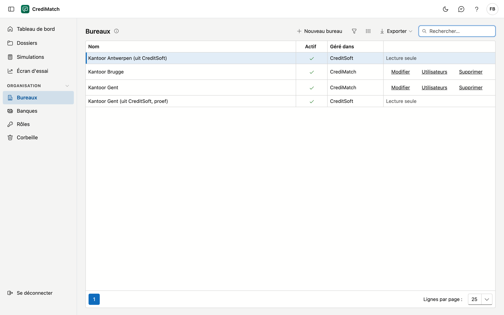
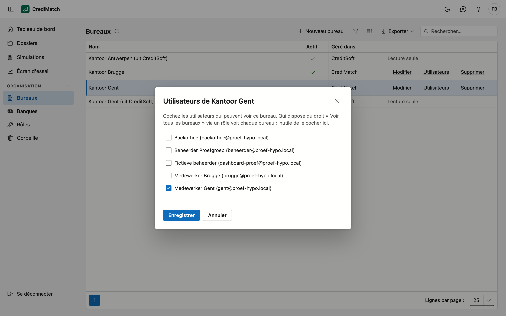

# Bureaux

Une organisation dans CrediMatch compte un ou plusieurs bureaux. Chaque utilisateur voit les bureaux auxquels il est
rattaché ; le back-office peut les voir tous. Sur cet écran, vous voyez vos bureaux, et l'administrateur de votre
organisation les gère.

## Ouvrir l'écran

Dans le menu, sous **Organisation**, cliquez sur **Bureaux**.

## Qui voit quel bureau

| Qui | Ce qu'il voit |
|---|---|
| Un utilisateur rattaché à un ou plusieurs bureaux | uniquement ces bureaux |
| Un utilisateur disposant du droit **Voir tous les bureaux** | tous les bureaux de l'organisation |
| L'administrateur de votre organisation | tous les bureaux, et il peut les gérer |
| Un utilisateur sans bureau et sans ce droit | aucun bureau |

Un utilisateur reçoit le droit **Voir tous les bureaux** via un rôle, par exemple pour le back-office qui suit les
dossiers de tous les bureaux.

## La liste

| Colonne | Ce que c'est |
|---|---|
| Nom | le nom du bureau |
| Actif | une coche si le bureau est en service |
| Géré dans | **CrediMatch**, ou **CreditSoft** pour un bureau qui vient de CreditSoft |

Un bureau géré dans **CreditSoft** est ici en **lecture seule** : vous le modifiez dans CreditSoft.

## Créer ou modifier un bureau

Seul l'administrateur de votre organisation peut le faire.

1. Cliquez sur **Nouveau bureau**, ou sur **Modifier** à côté d'un bureau.
2. Remplissez le **Nom**. Il est obligatoire : si vous le laissez vide et cliquez sur **Enregistrer**, la fenêtre
   indique ce qui manque.
3. Laissez **Actif** coché tant que le bureau est en service.
4. Cliquez sur **Enregistrer**.

## Choisir qui voit un bureau

1. Cliquez sur **Utilisateurs** à côté du bureau.
2. Cochez les utilisateurs qui peuvent voir ce bureau, et décochez ceux qui ne le peuvent plus.
3. Cliquez sur **Enregistrer**.

La modification s'applique immédiatement. Inutile de cocher un utilisateur qui dispose du droit **Voir tous les
bureaux** : il voit déjà chaque bureau.

## Supprimer un bureau

Cliquez sur **Supprimer** à côté du bureau et confirmez. Le bureau va dans la **corbeille** : qui n'était rattaché qu'à
ce bureau ne le voit plus. Vous le restaurez via **Organisation** > **Corbeille**.

## Erreurs fréquentes

!!! warning "Un collaborateur ne voit aucun bureau"
    Il n'est rattaché à aucun bureau et ne dispose pas du droit **Voir tous les bureaux**. Ouvrez **Utilisateurs** pour
    son bureau et cochez-le.

!!! warning "Modifier un bureau venant de CreditSoft"
    À côté d'un bureau géré dans CreditSoft figure **Lecture seule**. Modifiez le nom ou les utilisateurs de ce bureau
    dans CreditSoft.
