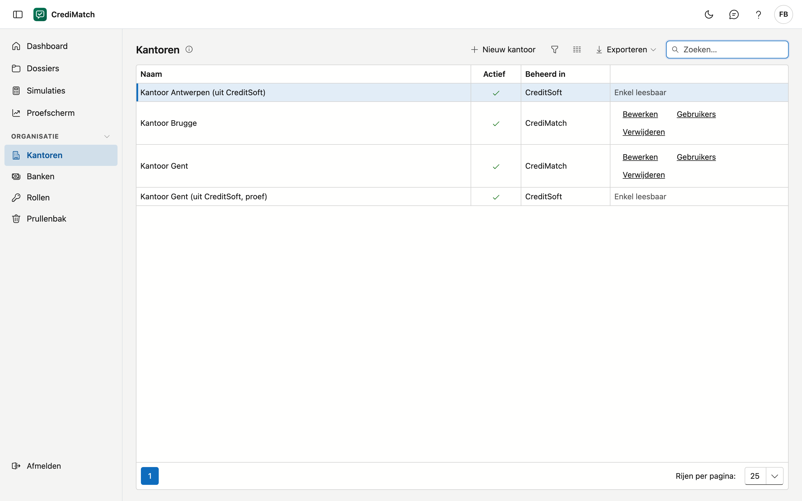
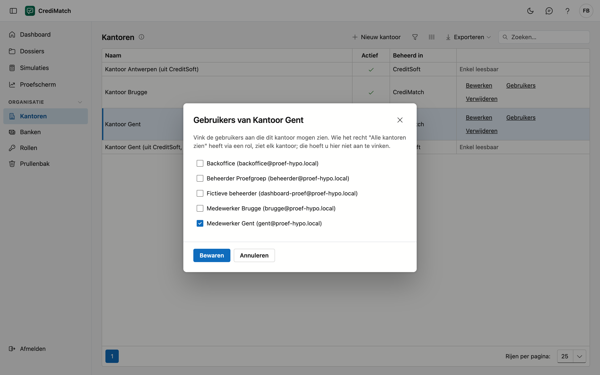

# Kantoren

Een organisatie in CrediMatch heeft één of meer kantoren. Elke gebruiker ziet de kantoren waarop hij staat; de backoffice
kan ze allemaal zien. Op dit scherm ziet u uw kantoren, en beheert de beheerder van uw organisatie ze.

## Het scherm openen

Klik in het menu onder **Organisatie** op **Kantoren**.

## Wie ziet welk kantoor

| Wie | Wat hij ziet |
|---|---|
| Een gebruiker die op één of meer kantoren staat | enkel die kantoren |
| Een gebruiker met het recht **Alle kantoren zien** | alle kantoren van de organisatie |
| De beheerder van uw organisatie | alle kantoren, en hij kan ze beheren |
| Een gebruiker zonder kantoor en zonder dat recht | geen enkel kantoor |

Het recht **Alle kantoren zien** krijgt een gebruiker via een rol, bijvoorbeeld voor de backoffice die de dossiers van
alle kantoren opvolgt.

## De lijst

| Kolom | Wat het is |
|---|---|
| Naam | de naam van het kantoor |
| Actief | een vinkje als het kantoor in gebruik is |
| Beheerd in | **CrediMatch**, of **CreditSoft** voor een kantoor dat uit CreditSoft komt |

Een kantoor dat in **CreditSoft** beheerd wordt, is hier **enkel leesbaar**: u wijzigt het in CreditSoft.

## Een kantoor aanmaken of wijzigen

Dit kan enkel de beheerder van uw organisatie.

1. Klik op **Nieuw kantoor**, of op **Bewerken** naast een kantoor.
2. Vul de **Naam** in. Die is verplicht: laat u ze leeg en klikt u op **Bewaren**, dan meldt het venster wat er
   ontbreekt.
3. Laat **Actief** aangevinkt zolang het kantoor in gebruik is.
4. Klik op **Bewaren**.

## Kiezen wie een kantoor ziet

1. Klik op **Gebruikers** naast het kantoor.
2. Vink de gebruikers aan die dit kantoor mogen zien, en vink uit wie het niet meer mag zien.
3. Klik op **Bewaren**.

De wijziging geldt meteen. Een gebruiker met het recht **Alle kantoren zien** hoeft u hier niet aan te vinken: hij ziet
elk kantoor al.

## Een kantoor verwijderen

Klik op **Verwijderen** naast het kantoor en bevestig. Het kantoor gaat naar de **prullenbak**: wie enkel op dit kantoor
stond, ziet het niet meer. U zet het terug via **Organisatie** > **Prullenbak**.

## Veelgemaakte fouten

!!! warning "Een medewerker ziet geen enkel kantoor"
    Hij staat op geen enkel kantoor en heeft het recht **Alle kantoren zien** niet. Open **Gebruikers** bij zijn
    kantoor en vink hem aan.

!!! warning "Een kantoor uit CreditSoft wijzigen"
    Naast een kantoor dat in CreditSoft beheerd wordt, staat **Enkel leesbaar**. Wijzig de naam of de gebruikers van
    dat kantoor in CreditSoft.
