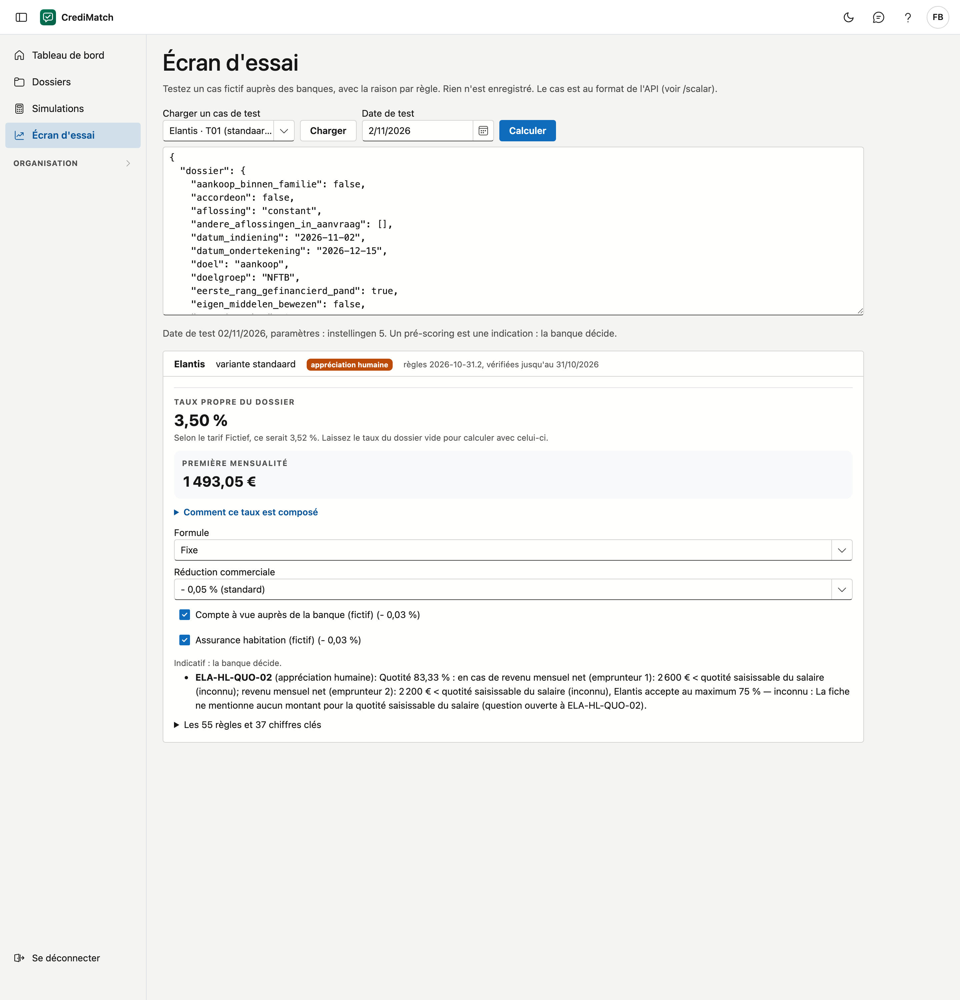

# Écran d'essai

Sur l'écran d'essai, vous vérifiez un cas fictif auprès des banques, sans créer de dossier. Pour chaque banque, vous voyez
le résultat et les règles qui pèsent, avec la raison. Rien n'est enregistré. Vous voyez ainsi rapidement comment une
banque réagit à un cas donné.

!!! note "Un droit"
    Vous ne voyez l'écran d'essai qu'avec le droit **Utiliser l'écran d'essai**. L'administrateur de votre organisation
    l'attribue via un rôle (voir [Rôles & droits](rollen.md)).

!!! note "Taux fictifs"
    Les taux, les réductions et les noms sur les images de ce manuel sont inventés. Les tarifs des banques ne sont visibles que dans
    CrediMatch, après la connexion.

## Ouvrir l'écran

Dans le menu, cliquez sur **Écran d'essai**.

## Vérifier un cas

1. Sous **Charger un cas de test**, choisissez un cas de test d'une banque et cliquez sur **Charger**. Le cas apparaît
   dans la zone de texte.
2. Adaptez les valeurs dans la zone de texte si vous voulez vérifier un autre cas. Le cas est au format qu'utilisent
   aussi d'autres logiciels ; les noms des données sont ceux des dossiers.
3. Choisissez éventuellement une autre **Date de test**. L'écran s'ouvre sur la date du jour ; un cas de test chargé
   apporte sa propre date, car son résultat attendu en dépend.
4. Cliquez sur **Calculer**.

Si vous avez chargé un cas de test, l'écran calcule uniquement pour cette banque et sa variante. Sans cas de test, il
calcule pour toutes les banques que votre organisation a activées (voir [Banques](banken.md)).

## Le résultat

Pour chaque banque, vous voyez :

- le **résultat** : positif, positif sous conditions, appréciation humaine, pas entièrement vérifié ou refus ;
- la version des règles et la date jusqu'à laquelle elles sont vérifiées ;
- le **taux** avec la mensualité et les choix, comme dans [Le taux par banque](dossiers.md#le-taux-par-banque). Un cas de test apporte généralement son propre taux, qui l'emporte. Retirez `rentevoet` de la zone de texte pour calculer avec le tarif en vigueur à la date de test ;
- les règles qui pèsent sur le résultat, avec leur raison ;
- sous **Les règles et chiffres clés** : chaque règle avec son état, et les chiffres calculés par la banque.

En haut figurent la date de test et les paramètres utilisés pour le calcul. Un pré-scoring est une indication : la banque
décide.

## Erreurs fréquentes

!!! warning "Le cas n'est pas correct"
    La zone de texte contient une donnée inconnue ou une valeur du mauvais type, par exemple du texte là où un nombre est
    attendu. L'écran cite chaque problème. En cas de doute, rechargez un cas de test et partez de là.

!!! warning "Une banque manque dans le résultat"
    Votre organisation a désactivé cette banque. Vous le voyez sous **Organisation** > **Banques**.

!!! warning "Un vrai client"
    N'utilisez pas l'écran d'essai pour un vrai client : il n'enregistre rien. Travaillez dans [Dossiers](dossiers.md),
    où vous enregistrez des simulations.

## Voir aussi

- [Dossiers](dossiers.md)
- [Banques](banken.md)
