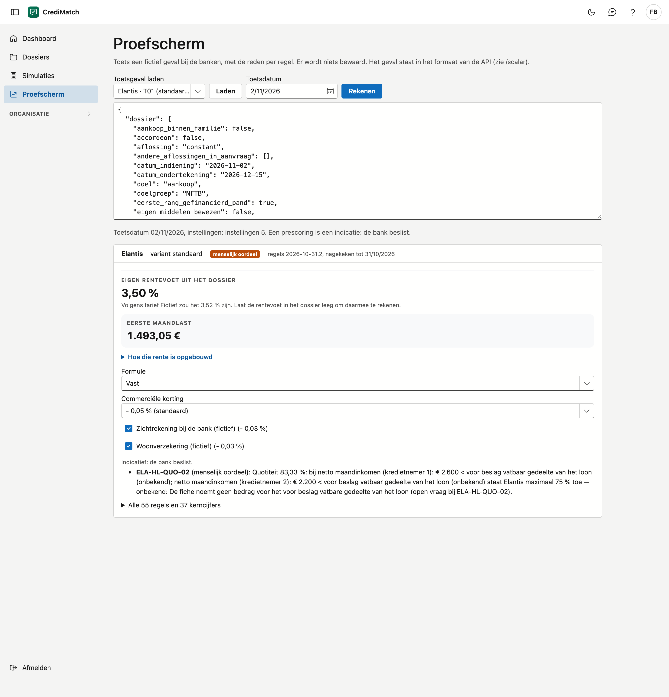

# Proefscherm

Op het proefscherm toetst u een fictief geval bij de banken, zonder een dossier aan te maken. U ziet per bank het oordeel
en de regels die erop wegen, met de reden. Er wordt niets bewaard. Zo gaat u snel na hoe een bank op een bepaald geval
reageert.

!!! note "Een recht"
    U ziet het proefscherm enkel met het recht **Proefscherm gebruiken**. De beheerder van uw organisatie geeft dat via
    een rol (zie [Rollen & rechten](rollen.md)).

!!! note "Fictieve rentes"
    De rentes, kortingen en namen op de beelden van deze handleiding zijn verzonnen. De tarieven van de banken ziet u enkel in
    CrediMatch zelf, na het aanmelden.

## Het scherm openen

Klik in het menu op **Proefscherm**.

## Een geval toetsen

1. Kies bij **Toetsgeval laden** een toetsgeval van een bank en klik op **Laden**. Het geval verschijnt in het tekstvak.
2. Pas de waarden in het tekstvak aan als u een ander geval wil toetsen. Het geval staat in het formaat dat ook andere
   software gebruikt; de namen van de gegevens zijn die van de dossiers.
3. Kies eventueel een andere **Toetsdatum**. Het scherm opent op vandaag; een geladen toetsgeval brengt zijn eigen
   datum mee, omdat zijn verwachte uitkomst daarvan afhangt.
4. Klik op **Rekenen**.

Hebt u een toetsgeval geladen, dan rekent het scherm enkel voor die bank en haar variant. Zonder toetsgeval rekent het
voor alle banken die uw organisatie aan heeft staan (zie [Banken](banken.md)).

## De uitkomst

Per bank ziet u:

- het **oordeel**: positief, positief onder voorwaarden, menselijk oordeel, niet volledig getoetst of weigering;
- de versie van de regels en tot wanneer ze nagekeken zijn;
- de **rente** met de maandlast en de keuzes, zoals bij [De rente per bank](dossiers.md#de-rente-per-bank). Een toetsgeval brengt meestal een eigen rentevoet mee, en die wint. Haal `rentevoet` uit het tekstvak om met het tarief te rekenen dat op de toetsdatum geldt;
- de regels die op het oordeel wegen, met hun reden;
- onder **Alle regels en kerncijfers**: elke regel met haar stand, en de cijfers die de bank berekent.

Bovenaan staan de toetsdatum en de instellingen waarmee gerekend werd. Een prescoring is een indicatie: de bank beslist.

## Veelgemaakte fouten

!!! warning "Het geval klopt niet"
    Het tekstvak bevat een onbekend gegeven of een waarde van het verkeerde soort, bijvoorbeeld tekst waar een getal
    hoort. Het scherm noemt elk probleem. Laad bij twijfel opnieuw een toetsgeval en vertrek daarvan.

!!! warning "Een bank ontbreekt in de uitkomst"
    Uw organisatie heeft die bank uitgezet. Dat ziet u onder **Organisatie** > **Banken**.

!!! warning "Een echte klant"
    Gebruik het proefscherm niet voor een echte klant: het bewaart niets. Werk in [Dossiers](dossiers.md), waar u
    simulaties bewaart.

## Zie ook

- [Dossiers](dossiers.md)
- [Banken](banken.md)
