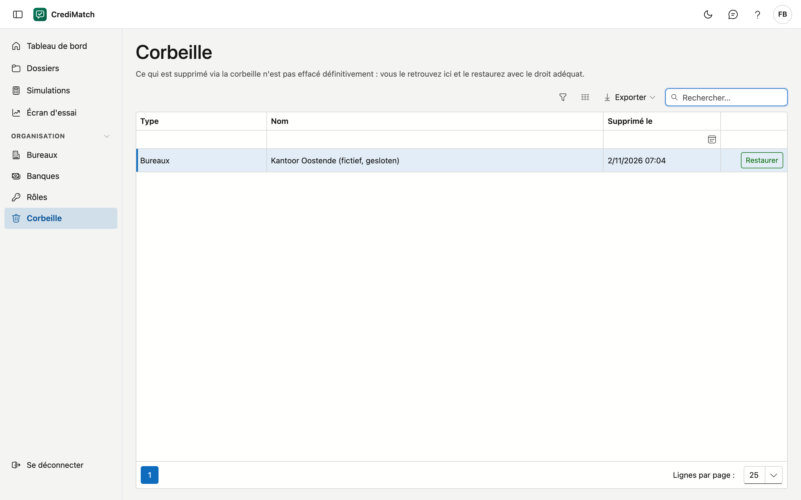

# Corbeille

Ce que vous supprimez dans CrediMatch, un [bureau](kantoren.md) ou un [dossier](dossiers.md#supprimer-un-dossier), n'est pas effacé définitivement. Vous le
retrouvez ici et le remettez en place.

## Ouvrir l'écran

Dans le menu, sous **Organisation**, cliquez sur **Corbeille**. Il vous faut le droit **Voir la corbeille** (voir
[Rôles & droits](rollen.md)).

## La liste

| Colonne | Ce que c'est |
|---|---|
| Type | ce qui a été supprimé : *Bureaux* ou *Dossiers* |
| Nom | le nom de ce qui a été supprimé |
| Supprimé le | quand cela a été supprimé |

Vous ne voyez que ce que vous pouviez voir avant la suppression : un bureau auquel vous n'êtes pas rattaché n'apparaît
pas ici.

Un dossier qui se trouve ici depuis 30 jours apparaît aussi parmi les dossiers [au-delà de la durée de conservation](bewaartermijn.md). Il reste ici jusqu'à ce que vous décidiez : rien ne disparaît automatiquement.

## Restaurer un élément

Cliquez sur **Restaurer** à côté de la ligne. L'élément reprend aussitôt sa place. Le bouton n'apparaît que si vous
disposez du droit **Restaurer des enregistrements**.
