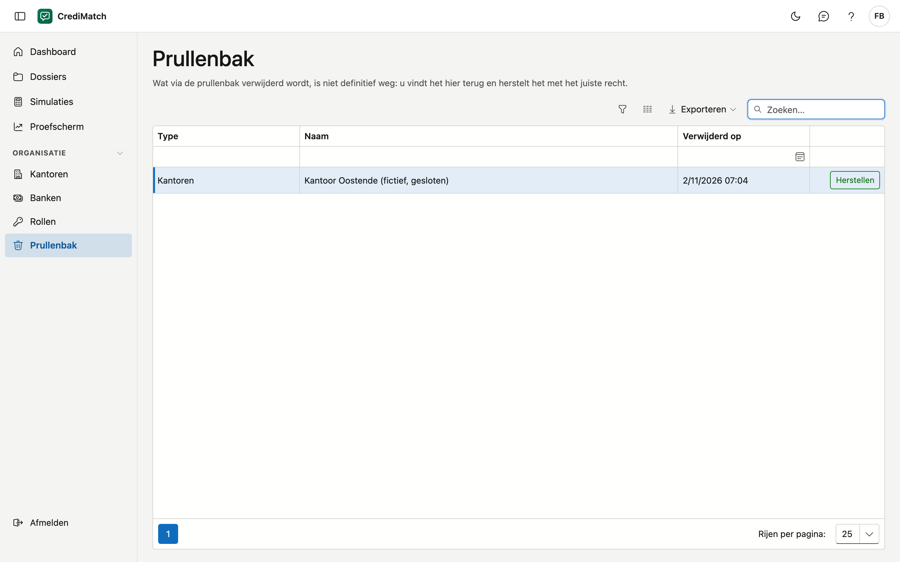

# Prullenbak

Wat u in CrediMatch verwijdert, bijvoorbeeld een [kantoor](kantoren.md), is niet definitief weg. U vindt het hier terug
en zet het terug.

## Het scherm openen

Klik in het menu onder **Organisatie** op **Prullenbak**. U hebt daarvoor het recht **Prullenbak bekijken** nodig (zie
[Rollen & rechten](rollen.md)).

## De lijst

| Kolom | Wat het is |
|---|---|
| Type | wat er verwijderd werd, bijvoorbeeld *Kantoren* |
| Naam | de naam van wat verwijderd werd |
| Verwijderd op | wanneer het verwijderd werd |

U ziet enkel wat u ook vóór het verwijderen kon zien: een kantoor waarop u niet staat, verschijnt hier niet.

## Iets herstellen

Klik op **Herstellen** naast de rij. Het staat meteen weer op zijn plaats. De knop staat er enkel als u het recht
**Verwijderde records herstellen** hebt.
