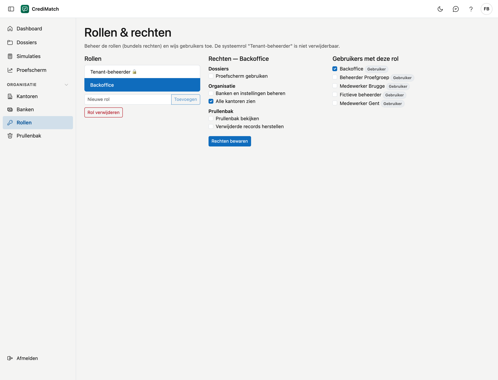

# Rollen & rechten

Een rol is een bundel rechten. U maakt een rol aan, kiest welke rechten erbij horen en geeft ze aan gebruikers. Zo geeft
u bijvoorbeeld de backoffice het recht om alle [kantoren](kantoren.md) te zien.

## Het scherm openen

Klik in het menu onder **Organisatie** op **Rollen**. Dit scherm is er voor de beheerder van uw organisatie.

## De systeemrol

De rol **Tenant-beheerder** heeft altijd alle rechten, ook rechten die later bijkomen. U kunt ze niet verwijderen en haar
rechten niet wijzigen. Wie deze rol heeft, beheert uw organisatie in CrediMatch.

## Een rol aanmaken

1. Typ onder **Rollen** de naam in het veld **Nieuwe rol**, bijvoorbeeld *Backoffice*.
2. Klik op **Toevoegen**. De rol staat in de lijst en is meteen geselecteerd.

## De rechten van een rol

1. Klik op de rol.
2. Vink in de kolom **Rechten** aan wat de rol mag.
3. Klik op **Rechten bewaren**. Naast de knop verschijnt **bewaard**.

| Recht | Wat het geeft |
|---|---|
| **Alle kantoren zien** | alle kantoren van uw organisatie, ook die waarop de gebruiker niet staat |
| **Prullenbak bekijken** | de [prullenbak](prullenbak.md) openen |
| **Verwijderde records herstellen** | iets uit de prullenbak terugzetten |
| **Banken en instellingen beheren** | kiezen met welke [banken](banken.md) uw organisatie werkt |
| **Proefscherm gebruiken** | het [proefscherm](proefscherm.md) openen: een fictief geval bij de banken toetsen |
| **Dossiers definitief wissen** | een dossier [definitief wissen](dossiers.md#een-dossier-definitief-wissen). Dat kan niet ongedaan gemaakt worden |

## Gebruikers een rol geven

Klik op de rol en vink rechts, onder **Gebruikers met deze rol**, de gebruikers aan. Uitvinken neemt de rol weer af. De
wijziging geldt meteen.

## Een rol verwijderen

Klik op de rol en daarna op **Rol verwijderen**. De gebruikers die ze hadden, verliezen de rechten die ze gaf.

## Veelgemaakte fouten

!!! warning "Rechten aangevinkt maar niet bewaard"
    Een vinkje in de kolom **Rechten** geldt pas na **Rechten bewaren**. De gebruikers van de rol vinkt u wel zonder
    bewaarknop aan.
