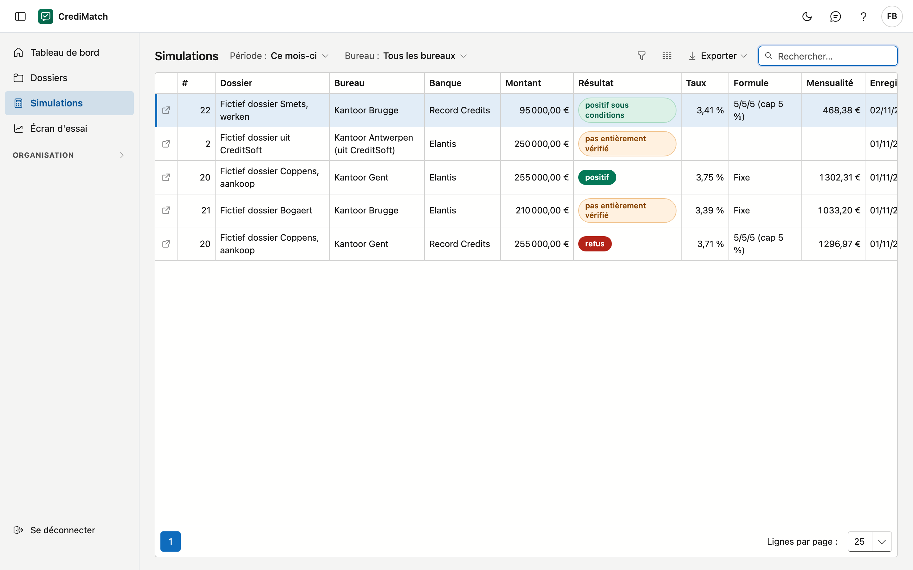

# Simulations

Sur cet écran, vous voyez toutes les simulations enregistrées de vos bureaux dans une seule liste, tous dossiers confondus. Vous y
voyez par exemple combien ont été enregistrées ce mois-ci, avec quel résultat et quel taux. Une simulation s'enregistre dans le dossier
lui-même (voir [Pré-scoring et simulations](dossiers.md#pre-scoring-et-simulations)).

!!! note "Taux fictifs"
    Les taux, les réductions et les noms sur les images de ce manuel sont inventés. Les tarifs des banques ne sont visibles que dans
    CrediMatch, après la connexion.

## Ouvrir l'écran

Dans le menu, cliquez sur **Simulations**. Depuis le [Tableau de bord](dashboard.md), la tuile **simulations ce mois-ci** ouvre
cette liste sur la période *Ce mois-ci*, et **Afficher les …** sur la carte *Dernières simulations* ouvre la liste complète.

## Filtrer

- **Période :** *Ce mois-ci*, *Mois passé*, *Ce trimestre*, *Cette année*, ou une période libre avec une date de début et de fin.
  Il s'agit du jour où la simulation a été enregistrée. *Toutes* les affiche toutes.
- **Bureau :** n'apparaît que si vous voyez plus d'un bureau.

## La liste

| Colonne | Ce que c'est |
|---|---|
| # | le numéro d'ordre du dossier |
| Dossier | la description du dossier |
| Bureau | le bureau auquel appartient le dossier |
| Banque | la banque auprès de laquelle la vérification a été faite |
| Montant | le montant de cette simulation. Il peut différer du crédit demandé dans le dossier |
| Résultat | le résultat au moment de l'enregistrement (voir [Pré-scoring et simulations](dossiers.md#pre-scoring-et-simulations)) |
| Taux | le taux avec lequel la vérification a été faite |
| Formule | la formule de la banque. Si **taux propre** y figure, le taux provenait du dossier ; **pas de taux** signifie que la vérification s'est faite sans taux. Vide pour une simulation plus ancienne sans taux |
| Mensualité | la première mensualité |
| Taux selon | **tarif** avec la version de la banque, ou **taux propre**. Cette colonne s'affiche avec le choix des colonnes |
| Enregistrée le | le jour et l'heure de l'enregistrement |
| Par | la personne qui a enregistré la simulation. Cette colonne s'affiche avec le choix des colonnes |

Cliquez sur une ligne pour ouvrir le dossier. Avec **Exporter**, vous emportez la liste, par exemple vers Excel.

Un dossier à la corbeille et ses simulations ne figurent pas dans cette liste. Un pré-scoring est une indication : la banque décide.

## Erreurs fréquentes

!!! warning "Une simulation n'apparaît pas dans la liste"
    Vérifiez d'abord la **Période** : si elle est sur *Ce mois-ci*, vous ne voyez pas les plus anciennes. Le calcul seul n'enregistre
    rien non plus : seul ce que vous avez enregistré avec **Enregistrer comme simulation** figure ici.

!!! warning "Le chiffre diffère de la colonne Simulations de la liste des dossiers"
    Cette liste affiche une ligne par simulation. La liste des dossiers affiche une ligne par dossier, avec le nombre de
    simulations de ce dossier.

## Voir aussi

- [Tableau de bord](dashboard.md)
- [Dossiers](dossiers.md)
