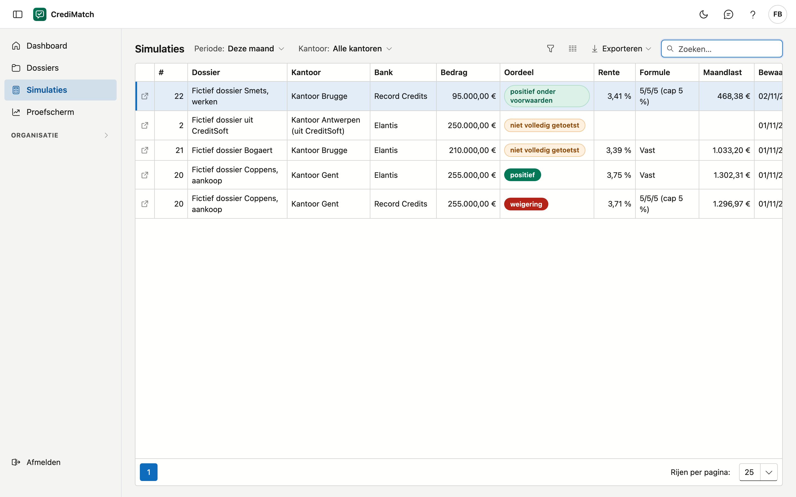

# Simulaties

Op dit scherm ziet u alle bewaarde simulaties van uw kantoren in één lijst, over de dossiers heen. U ziet er bijvoorbeeld
hoeveel er deze maand bewaard zijn, met welk oordeel en welke rente. Een simulatie bewaren doet u in het dossier zelf (zie
[Prescoring en simulaties](dossiers.md#prescoring-en-simulaties)).

!!! note "Fictieve rentes"
    De rentes, kortingen en namen op de beelden van deze handleiding zijn verzonnen. De tarieven van de banken ziet u enkel in
    CrediMatch zelf, na het aanmelden.

## Het scherm openen

Klik in het menu op **Simulaties**. Vanuit het [Dashboard](dashboard.md) opent de tegel **simulaties deze maand** deze lijst op
de periode *Deze maand*, en **Alle … tonen** op de kaart *Laatste simulaties* de hele lijst.

## Filteren

- **Periode:** *Deze maand*, *Vorige maand*, *Dit kwartaal*, *Dit jaar*, of een eigen periode met een begin- en einddatum.
  Het gaat om de dag waarop de simulatie bewaard is. *Alle* toont ze allemaal.
- **Kantoor:** staat er enkel als u meer dan één kantoor ziet.

## De lijst

| Kolom | Wat het is |
|---|---|
| # | het volgnummer van het dossier |
| Dossier | de omschrijving van het dossier |
| Kantoor | het kantoor waar het dossier bij hoort |
| Bank | de bank waarbij getoetst werd |
| Bedrag | het bedrag van deze simulatie. Dat kan verschillen van het gevraagde krediet in het dossier |
| Oordeel | het oordeel op het moment van bewaren (zie [Prescoring en simulaties](dossiers.md#prescoring-en-simulaties)) |
| Rente | de rente waarmee getoetst werd |
| Formule | de formule van de bank. Staat er **eigen rentevoet**, dan kwam de rente uit het dossier; **geen rentevoet** betekent dat de toets zonder rente liep. Leeg bij een oudere simulatie zonder rente |
| Maandlast | de eerste maandlast |
| Rente volgens | **tarief** met de versie van de bank, of **eigen rentevoet**. Deze kolom toont u met de kolomkeuze |
| Bewaard op | de dag en het uur van bewaren |
| Door | wie de simulatie bewaard heeft. Deze kolom toont u met de kolomkeuze |

Klik op een rij om het dossier te openen. Met **Exporteren** neemt u de lijst mee naar bijvoorbeeld Excel.

Een prescoring is een indicatie: de bank beslist.

## Veelgemaakte fouten

!!! warning "Een simulatie staat niet in de lijst"
    Kijk eerst de **Periode** na: staat die op *Deze maand*, dan ziet u de oudere niet. Rekenen alleen bewaart ook niets: enkel wat u
    bewaarde met **Bewaar als simulatie**, staat hier.

!!! warning "Het getal verschilt van de kolom Simulaties in de dossierlijst"
    Deze lijst toont één rij per simulatie. De dossierlijst toont één rij per dossier, met het aantal simulaties van dat dossier.

## Zie ook

- [Dashboard](dashboard.md)
- [Dossiers](dossiers.md)
